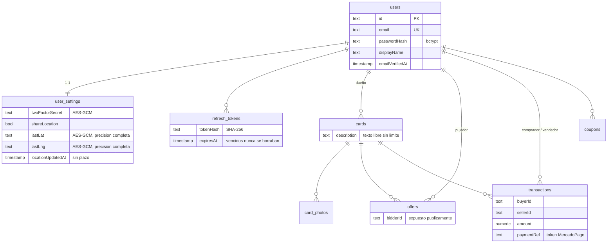
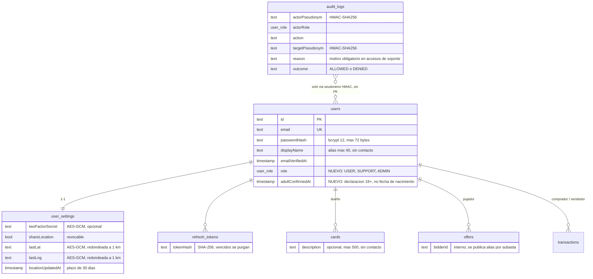

# Actividad N°4 — Rediseño seguro de la base de datos e implementación de controles de privacidad y acceso

**Nombre:** Grupo MTG Companion  
**Integrantes:** Vicente Fuentes, Tomás Rodriguez, Tomás Solano  
**Fecha:** 23 oct 2026  
**Proyecto:** MTG Companion — app de compraventa de cartas Magic (`apps/`): backend NestJS + Prisma + PostgreSQL, cliente Ionic/React  
**Repositorio:** https://github.com/inzenfenix/MTGCompanion_TCG · tarea: [issue #148](https://github.com/inzenfenix/MTGCompanion_TCG/issues/148) · commit de implementación `f1f7a50`  
**Insumos:** inventario del Hito 1 ([`hito1/`](hito1/)), mapa CIA de la Actividad N°1 ([`MAPEO_CIA.md`](MAPEO_CIA.md)), cifrado de la Actividad N°2 ([`ACTIVIDAD_2.md`](ACTIVIDAD_2.md))

El Hito 1 dejó anotadas brechas concretas: la ubicación se guardaba con precisión completa y sin plazo,
no se podía dejar de compartirla, no había verificación de edad y no existía ningún rol. Al revisar el
código para esta actividad apareció una más grave: **tres rutas de transacciones respondían sin sesión**
(cualquiera con un id podía leer quién compró qué, a quién y por cuánto). Esta entrega corrige todo eso
en el código, no solo en el diseño.

---

## 1. Esquema de base de datos rediseñado

### 1.1 Esquema original (tablas con datos personales)



### 1.2 Esquema rediseñado



La comparación columna por columna, leída de un PostgreSQL 16 real antes y después de la migración
[`20261023120000_rbac_audit_minimization`](../../apps/backend/prisma/migrations/20261023120000_rbac_audit_minimization/migration.sql),
está en [`evidencia/actividad4/03_esquema_antes_despues.txt`](evidencia/actividad4/03_esquema_antes_despues.txt),
junto con la verificación de que `schema.prisma` y las migraciones no difieren (*drift* = 0).

Varias decisiones **no cambian columnas** pero sí qué se guarda: el redondeo de la ubicación, el plazo, la
purga y los límites de texto se aplican en el código antes de escribir (§4).

### 1.3 Tabla de decisiones

| Tabla y campo | Decisión | Justificación |
|---|---|---|
| Usuarios: fecha de nacimiento | **Eliminar** (nunca se pide) → se reemplaza por `adultConfirmedAt` | La app solo necesita saber que el jugador es mayor de edad (hay pagos reales), no cuándo nació. Se guarda **cuándo** declaró tener 18+, no su edad. Así no se tratan datos de menores (Ley 19.628, art. 16 quáter) sin pedir un dato que permita identificar a la persona. |
| Usuarios: teléfono, RUT, dirección, nombre legal | **No se recolectan** | Ninguna función los usa: el contacto es el email y la entrega de la carta se acuerda dentro de la app. El registro rechaza con 400 cualquier campo extra (`forbidNonWhitelisted`), así que no hay forma de guardarlos por error. |
| Usuarios: `email` | **Mantener** | Es el identificador de inicio de sesión y el único canal de contacto (bienvenida, comprobantes). No se muestra a otros jugadores (`GET /users/:id` devuelve solo id y alias) y el personal ve una versión enmascarada (`v***@g***.com`). Conservar más de un medio de contacto no aportaría nada. |
| Usuarios: `passwordHash` | **Mantener con protección adecuada** | Necesaria para autenticar, guardada como bcrypt (costo 12, sal por usuario), nunca en texto plano. Ahora se rechazan contraseñas de más de 72 bytes, porque bcrypt ignora en silencio lo que pasa de ese largo. |
| Usuarios: `displayName` | **Mantener, reducido** | Es un **alias** público para la contraparte, no un nombre legal. Máximo 40 caracteres y se rechaza si contiene un email o un teléfono, para que no se convierta en un lugar donde publicar datos de contacto. |
| Usuarios: `emailVerifiedAt` | **Mantener** | Indica si el email fue verificado. Alternativa: reducirlo a un booleano. Se mantiene la fecha porque sirve para auditoría, y en las copias de desarrollo se trunca al día. |
| Usuarios: `role` | **Nuevo, necesario** | Soporta el control de acceso (§3). No es un dato sensible. Por defecto `USER`. |
| Configuración: `twoFactorSecret` | **Opcional, protegido** | Solo existe si el jugador activa 2FA. Cifrado con AES-256-GCM (Actividad N°2) y se borra al desactivar 2FA. |
| Configuración: `lastLat` / `lastLng` | **Reducir + plazo + opcional y revocable** | Sirven para mostrar "a cuántos km está el vendedor", y basta con kilómetros. Antes se guardaba la posición GPS exacta (≈1 m, suficiente para ubicar una casa). Ahora se **redondea a 2 decimales (~1 km)** antes de cifrar, la búsqueda **ignora** las ubicaciones con más de 30 días, una tarea de retención **las borra** y el jugador puede **revocarla** (`DELETE /users/me/location`). Geolocalización = categoría especial (Ley 19.628, art. 16 sexies). |
| Configuración: `shareLocation` | **Mantener** | Registra el consentimiento. Ahora también se puede retirar desde Seguridad en la app. |
| Configuración: `locationUpdatedAt` | **Mantener** | Es necesario para aplicar el plazo. Se borra junto con la ubicación. |
| Configuración: `language`, `theme`, `notifyByEmail` | **Mantener** | Preferencias sin sensibilidad. |
| Tokens de sesión: `tokenHash` | **Mantener**; los **vencidos se eliminan** | El hash SHA-256 es necesario para renovar la sesión. Las filas vencidas ya no sirven, pero cada una vincula a un usuario con una hora de inicio de sesión: se purgan en cada arranque (`purge-expired-data`). |
| Cartas: `description` | **Opcional, reducido** | Es texto público de la publicación. Ahora tiene un máximo de 500 caracteres y se rechaza si incluye un email o un teléfono. |
| Cartas: `setName`, `rarity`, `oracleText` | **Mantener** (no son personales) | Son datos públicos de Scryfall. Alternativa propuesta: derivarlos de `catalog_cards` a partir de `scryfallId`, por redundancia y no por privacidad. |
| Fotos: `storageKey` | **Mantener** | Se necesita para mostrar la carta. Las fotos podrían mostrar manos o el fondo de una casa (riesgo residual, §6). |
| Ofertas: `bidderId` | **Mantener internamente, seudonimizar al exponer** | Es necesario para resolver la subasta y cobrar al ganador. Antes se publicaba tal cual en el estado de la subasta, que es público; ahora sale un alias por subasta (§2). |
| Transacciones: `buyerId`, `sellerId`, `amount` | **Mantener** | Son la ejecución del contrato de compraventa y el respaldo tributario. Su lectura quedó restringida a las dos partes (§3). |
| Transacciones: `paymentRef` | **Mantener** (es un token) | MercadoPago es la bóveda y esto es solo la referencia (tokenización, Actividad N°2). En las copias de desarrollo se borra. |
| Auditoría: `audit_logs` | **Nueva tabla, seudonimizada** | Registra los accesos sensibles y los intentos denegados **sin** guardar ids reales ni emails, y es de solo inserción (trigger en la BD). |
| Búsqueda: `?lat=&lng=` del comprador | **No se almacena** | Se usa solo para calcular las distancias de esa búsqueda. |

### 1.4 Alternativas para reducir aún más (propuestas, no implementadas)

- **Guardar la ubicación solo de quienes venden.** Hoy se guarda la de cualquier jugador con sesión que abre el Bazar y da permiso. La del comprador no se necesita guardar, porque viaja en la consulta.
- **Reducir `emailVerifiedAt` a un booleano**, si la fecha deja de usarse para auditoría.
- **Derivar los datos de la carta** desde `catalog_cards` en vez de copiarlos en `cards`.
- **Recorte automático de las fotos** a la silueta de la carta antes de subirlas. El cliente ya localiza la carta con OpenCV, así que se descartarían el fondo y las manos.

### 1.5 Cómo contribuye el nuevo diseño a la minimización

1. **Lo que no se pide no se puede filtrar:** el registro acepta exactamente 4 campos (email, contraseña, alias y declaración 18+) y rechaza todo lo demás.
2. **Menos precisión donde basta:** ~1 km en vez de ~1 m de ubicación, y una declaración en vez de una fecha de nacimiento.
3. **Menos tiempo:** la ubicación vence a los 30 días y los tokens vencidos se borran (proporcionalidad, Ley 19.628, art. 3 c).
4. **Menos exposición:** el email enmascarado para el personal, un alias en vez del id del pujador, nada de ids en la auditoría y transacciones visibles solo para sus partes.
5. **Control del titular:** puede retirar la ubicación con un interruptor, y la eliminación es real, no solo ocultar el dato.

---

## 2. Seudonimización y anonimización

### 2.1 Los dos conceptos, aplicados aquí

- **Seudonimización:** se reemplaza el id del usuario por `u_` + 16 caracteres hexadecimales de **HMAC-SHA256(llave, ámbito:id)**. Sin la llave el código no dice nada, pero **con la llave y la tabla de usuarios se puede revertir**, así que sigue siendo dato personal y se protege como tal.
- **Anonimización:** los datos se transforman de modo que **no exista** forma razonable de volver a la persona: se agregan, se generalizan, se suprimen o se reemplazan por valores inventados, **sin guardar** ninguna tabla de correspondencia.

¿Por qué HMAC y no un hash simple? Los ids de usuario (UUID) ya circulan: aparecen en publicaciones, en
transacciones y en el cliente. Un `SHA-256(id)` se podría revertir hasheando todos los ids conocidos y
comparando. Con una llave secreta eso no es posible. Además el seudónimo tiene **ámbito**: el mismo
jugador tiene un código distinto en cada subasta, así que nadie lo puede seguir de una subasta a otra.

### 2.2 Dónde se aplica cada técnica

| Dónde (tabla / proceso / módulo) | Técnica | Cómo se implementa | Qué protege | Por qué esta técnica |
|---|---|---|---|---|
| **Registro de auditoría** (`audit_logs`, `AuditService`) | Seudonimización (HMAC, ámbito `audit`) | Actor y afectado se guardan como `u_xxxxxxxxxxxxxxxx`, sin FK a `users` | Quién accedió a qué y quién fue afectado | La auditoría **debe** poder vincularse a una persona si hay un incidente, así que la anonimización la inutilizaría. El seudónimo es estable (permite seguir a un actor), pero leer la tabla no basta para saber quién es. |
| **Estado público de una subasta** (`GET /cards/:id/offers`, WebSocket `auction-update`) | Seudonimización (HMAC, ámbito `bid:<cardId>`) | `bidderAlias` en vez de `bidderId`; `mine: true/false` solo para quien consulta con sesión | Identidad y comportamiento de quien puja | Dentro de una subasta hay que distinguir "el mismo postor subió", y entre subastas no hay que poder vincularlo. Un alias con ámbito por carta cumple ambas cosas. |
| **Logs de la aplicación** (listeners y proveedores de email, `SafeExceptionFilter`) | Enmascarado / supresión | `maskEmail()` → `v***@g***.com`; `redactPersonalData()` borra teléfonos, RUT y JWT del mensaje; los errores 500 se registran con un `errorId` y nunca con el cuerpo de la petición | Emails y otros datos que se cuelan en mensajes de error | Los logs se copian y retienen más que la BD y los lee más gente. Para depurar basta distinguir dos mensajes, no identificar a la persona. |
| **Reporte de ventas** (`GET /admin/reports/sales`) | Anonimización (agregación + generalización + supresión, **k-anonimato k=5**) | Celdas mes × condición × medio de pago; una celda se publica solo si la respaldan ≥5 compradores **y** ≥5 vendedores distintos; montos redondeados; sin total general | Quién compró o vendió, y cuánto | El reporte es para decidir sobre el negocio y no necesita personas. Una celda con una sola venta identificaría a los dos jugadores, por eso se suprime. Sin total general, una celda suprimida no se puede reconstruir restando las publicadas. |
| **Copias de la BD para desarrollo, pruebas o demos** (`npm run db:anonymize`) | Anonimización (sustitución + supresión + generalización) | Email → `user-<n>@example.invalid` y alias → `Jugador <n>` (n en orden aleatorio); una contraseña conocida de desarrollo; se borran 2FA, ubicación, sesiones, fotos, descripciones y `paymentRef`; fechas truncadas al día; la auditoría se vacía | Todo dato que identifica o contacta a un jugador | El equipo de desarrollo no necesita personas reales para reproducir un error del marketplace. No queda tabla de correspondencia, así que no hay vuelta atrás. Se niega a correr con `NODE_ENV=production` o sin `--confirm-dev-copy`. |
| **Pruebas automatizadas** (`test/`, `prisma/seed.ts`) | Datos ficticios | Las pruebas crean y borran cuentas `@example.com`; la BD de prueba es efímera (Postgres embebido en una carpeta temporal) y las llaves se generan al azar en cada corrida | Que ningún dato real ni ninguna llave real aparezca en pruebas | Lo más seguro es que el dato real nunca llegue al entorno de prueba. |

### 2.3 Ejemplos concretos del sistema

**Auditoría.** Cuando el soporte consulta las compras de un jugador queda una fila con esta forma (la escribe la prueba e2e; los seudónimos cambian en cada corrida porque la llave de prueba es aleatoria):

```text
actorPseudonym  = u_3f9c1e07a2b84d55        ← no es el UUID del funcionario de soporte
actorRole       = SUPPORT
action          = support.transactions.read
targetPseudonym = u_a81d0c4be9f2376e        ← no es el UUID del jugador consultado
reason          = Disputa O14-e2e: carta no recibida
outcome         = ALLOWED
```

La prueba `access-control` verifica que **ninguna** fila de `audit_logs` contenga el id real ni el email de los participantes.

**Subasta.** Respuesta pública antes y después:

```jsonc
// antes (cualquiera, sin sesión)
{ "id": "…", "bidderId": "2b6f…-…-…", "amount": 6 }
// ahora, sin sesión
{ "id": "…", "bidderAlias": "u_5c0e93d1f4a27b88", "amount": 6 }
// ahora, consultado por el propio pujador
{ "id": "…", "bidderAlias": "u_5c0e93d1f4a27b88", "amount": 6, "mine": true }
```

El mismo jugador en otra carta aparece como otro alias (lo verifica `privacy-controls`).

**Reporte.** Forma de la respuesta (valores ilustrativos), sin ids y sin conteos por persona:

```json
{ "k": 5, "generatedAt": "…", "cells": [ { "month": "2026-10", "condition": "NM", "paymentMethod": "CASH", "sales": 12, "total": 418000 } ], "suppressedCells": 7 }
```

### 2.4 Registros, reportes, pruebas y ambientes de desarrollo

- **Registros:** ningún log escribe un email completo. En toda la corrida e2e hubo **64 líneas de log del servidor, con 0 emails completos y 32 enmascarados** ([`04_logs_sin_datos_personales.txt`](evidencia/actividad4/04_logs_sin_datos_personales.txt)). Los errores internos responden `{"statusCode":500,"message":"Internal server error","errorId":"…"}`, sin nombres de tabla, columna ni valores (por ejemplo, el mensaje de una restricción única de Prisma ya no llega al cliente).
- **Reportes:** solo el agregado k-anónimo; no existe ningún endpoint que liste transacciones de terceros sin motivo y sin auditoría.
- **Pruebas:** datos ficticios, BD efímera y llaves aleatorias.
- **Desarrollo:** el seed crea cuentas `@example.com`, y si alguna vez hace falta una copia de producción, se anonimiza con `db:anonymize` antes de que salga del ambiente productivo.

### 2.5 Quién puede revertir una seudonimización

Para revertir hacen falta **dos cosas a la vez**: la llave `PSEUDONYM_KEY` y la lista de ids reales (la tabla `users`).

| Restricción | Cómo se cumple |
|---|---|
| La llave no está en el código ni en la BD | Variable de entorno; en producción viene de AWS Secrets Manager (`pseudonym_key` en [`secrets.tf`](../../infra/terraform/secrets.tf)) y la recibe solo el contenedor del backend. Sin llave, el backend **no arranca**, ni en desarrollo. |
| Llave separada | Es distinta de `FIELD_ENCRYPTION_KEY` y de `JWT_SECRET`: filtrar una no compromete a las otras. |
| Solo un ADMIN puede pedir la reversión | `POST /admin/pseudonyms/resolve` exige el permiso `pseudonym:resolve` (solo ADMIN) y un **motivo** de 10 a 200 caracteres sin datos de contacto. |
| La reversión queda registrada | Cada consulta escribe una fila `admin.pseudonym.resolve` con el afectado como objetivo: queda constancia de **a quién** se re-identificó y por qué. |
| Devuelve lo mínimo | Devuelve id y alias, no el email. |
| Nadie puede borrar ese rastro | `audit_logs` rechaza UPDATE, DELETE y TRUNCATE a nivel de PostgreSQL. |

---

## 3. Modelo de control de acceso basado en roles (RBAC)

### 3.1 Roles y responsabilidades

| Rol | Quién | Responsabilidad |
|---|---|---|
| **USER** (usuario final) | Todo jugador; es el rol por defecto | Gestionar su colección, publicar, pujar, comprar y vender, y administrar su cuenta y su privacidad. |
| **SUPPORT** (personal autorizado) | Equipo que atiende reclamos | Resolver disputas entre comprador y vendedor: encontrar las cuentas involucradas y ver sus transacciones, **siempre indicando un motivo**. |
| **ADMIN** (administrador) | Responsables de la plataforma (2–3 personas) | Asignar roles, revisar la auditoría, ver los reportes anonimizados y, excepcionalmente, re-identificar un seudónimo. |

El primer ADMIN solo se puede crear con acceso directo al servidor (`npm run user:set-role -- <email> ADMIN`),
y queda auditado como `system`. Después, los roles se gestionan por la API, y un ADMIN **no puede cambiar su
propio rol** (se necesita un segundo administrador).

### 3.2 Matriz de permisos

| Acción o recurso | Administrador | Personal autorizado (SUPPORT) | Usuario final |
|---|---|---|---|
| Gestionar roles y permisos (`PATCH /admin/users/:id/role`) | **Permitido**, salvo su propio rol; auditado | Denegado | Denegado |
| Listar cuentas (`GET /admin/users`) | Permitido, con el email **enmascarado** | Permitido, con el email **enmascarado** | Denegado |
| Consultar datos propios (perfil, transacciones, colección) | Permitido | Permitido | Permitido |
| Consultar transacciones de otros usuarios | Solo con motivo, **auditado** | Solo con motivo, **auditado** | **Denegado** (403) |
| Leer una transacción o su comprobante | Las propias; las ajenas, por la vía de soporte | Las propias; las ajenas, por la vía de soporte | Solo si es comprador o vendedor (403 si no) |
| Perfil público de otro jugador (id + alias) | Permitido | Permitido | Permitido (con sesión) |
| Modificar información sensible (contraseña, 2FA, ubicación) | Solo la propia | Solo la propia | Solo la propia |
| Ver ubicación, secreto 2FA o hash de contraseña de otro | **Denegado** (no existe la ruta) | **Denegado** | **Denegado** |
| Modificar o borrar cartas y mazos de otro | Denegado | Denegado | Denegado (404) |
| Leer el registro de auditoría | Permitido (seudonimizado) | Denegado | Denegado |
| Reporte de ventas | Permitido (anonimizado) | Denegado | Denegado |
| Revertir un seudónimo | Solo con motivo, **auditado** | Denegado | Denegado |
| Modificar o borrar entradas de auditoría | **Denegado**, también en la BD (trigger) | Denegado | Denegado |
| Acceder a claves criptográficas | **Ninguna persona por la API**: solo el proceso backend las lee de su entorno o de Secrets Manager; cambiarlas es una operación de infraestructura | Denegado | Denegado |
| Cambiar el esquema de la BD | Solo el operador, con el rol dueño de la BD y mediante migraciones; nunca la app | Denegado | Denegado |

La misma matriz está escrita como prueba unitaria ([`permissions.spec.ts`](../../apps/backend/src/common/auth/permissions.spec.ts)):
si alguien amplía un rol en el código sin actualizar la matriz, la prueba falla.

### 3.3 Acciones y datos explícitamente denegados

- **USER:** cualquier ruta `/admin/*`; las transacciones o comprobantes en los que no participa; `?userId=` de otra persona; su propio ascenso de rol; editar cartas o mazos ajenos; los ids reales de quienes pujan.
- **SUPPORT:** cambiar roles; leer la auditoría (ni la propia ni la de sus pares); reportes; revertir seudónimos; ver emails completos, ubicación, 2FA o contraseñas; consultar transacciones ajenas **sin motivo**; modificar datos de otros.
- **ADMIN:** cambiar su propio rol; modificar o borrar la auditoría; ver ubicación, 2FA o contraseñas (no existe ninguna ruta que los entregue, ni para ADMIN); ver emails completos desde la API; obtener las llaves.

### 3.4 Mínimo privilegio

- **Deny-by-default:** un permiso que no aparece en la tabla está denegado. No hay comodines ni herencia entre roles, y USER no tiene ningún permiso elevado (lo propio se controla por **propiedad**, no por rol).
- **SUPPORT recibe solo 2 permisos** (`users:list`, `transactions:read:any`), los justos para resolver disputas.
- **También en la base de datos:** el script [`least-privilege-role.sql`](../../apps/backend/prisma/sql/least-privilege-role.sql) crea `mtg_app`, el usuario con que debería conectarse la API. Puede leer y escribir filas, pero no puede crear, alterar ni borrar tablas, no puede tocar el historial de migraciones ni escribir el catálogo, y en `audit_logs` solo puede insertar y leer.

### 3.5 Cómo se controla el acceso a información sensible y a operaciones administrativas

Cada petición pasa por varias capas independientes:

1. **Autenticación:** `JwtAuthGuard` exige un token firmado y vigente; si falta o es inválido, responde 401.
2. **El rol se lee de la BD en cada petición** (`JwtStrategy`), no del token: degradar a alguien o borrar su cuenta surte efecto **en la siguiente petición**, no cuando el token vence 15 minutos después (está probado).
3. **Autorización:** `PermissionsGuard` compara la ruta con la tabla rol → permiso. Si falta el permiso responde **403 genérico** (no revela qué permiso faltaba) y **registra el intento** en la auditoría.
4. **Propiedad:** las consultas propias filtran por el usuario de la sesión (por ejemplo, transacciones donde `buyerId` o `sellerId` es el solicitante).
5. **Motivo y auditoría** en todo acceso a datos de terceros.
6. **La base de datos** impone lo suyo: auditoría inmutable por trigger y el rol `mtg_app` sin DDL.

---

## 4. Implementación en el código

| Archivo | Qué hace |
|---|---|
| [`prisma/schema.prisma`](../../apps/backend/prisma/schema.prisma), [migración `20261023120000`](../../apps/backend/prisma/migrations/20261023120000_rbac_audit_minimization/migration.sql) | Agrega `Role`, `users.role`, `users.adultConfirmedAt` y la tabla `audit_logs`, más el trigger que rechaza UPDATE, DELETE y TRUNCATE. |
| [`common/auth/permissions.ts`](../../apps/backend/src/common/auth/permissions.ts) | La tabla rol → permiso, única fuente de verdad. |
| [`common/auth/permissions.guard.ts`](../../apps/backend/src/common/auth/permissions.guard.ts), [`require-permissions.decorator.ts`](../../apps/backend/src/common/auth/require-permissions.decorator.ts) | `@RequirePermissions(...)` y el guard que la aplica, con auditoría de los intentos denegados. |
| [`auth/presentation/jwt.strategy.ts`](../../apps/backend/src/auth/presentation/jwt.strategy.ts) | Lee el rol desde la BD en cada petición y rechaza los tokens de cuentas borradas. |
| [`admin/`](../../apps/backend/src/admin/) (dominio, aplicación, infraestructura y presentación) | Rutas de administración y soporte; [`k-anonymity.ts`](../../apps/backend/src/admin/domain/k-anonymity.ts) genera el reporte anonimizado. |
| [`transactions/…/transactions.controller.ts`](../../apps/backend/src/transactions/presentation/transactions.controller.ts), [`transactions.service.ts`](../../apps/backend/src/transactions/application/transactions.service.ts) | **Cierra el IDOR**: las tres lecturas exigen sesión y solo devuelven lo propio. |
| [`common/privacy/pseudonym.service.ts`](../../apps/backend/src/common/privacy/pseudonym.service.ts), [`privacy.module.ts`](../../apps/backend/src/common/privacy/privacy.module.ts) | HMAC-SHA256 con ámbito; `resolve()` para la re-identificación controlada. Sin `PSEUDONYM_KEY`, no arranca. |
| [`common/audit/audit.service.ts`](../../apps/backend/src/common/audit/audit.service.ts) | Único punto que escribe la auditoría, y siempre con seudónimos. |
| [`offers/…/offers.service.ts`](../../apps/backend/src/offers/application/offers.service.ts), [`public-offer.ts`](../../apps/backend/src/offers/domain/public-offer.ts) | Alias por subasta y `mine`; el `bidderId` ya no sale del servicio. |
| [`common/privacy/redact.ts`](../../apps/backend/src/common/privacy/redact.ts), [`no-contact-info.validator.ts`](../../apps/backend/src/common/privacy/no-contact-info.validator.ts) | Enmascarado de logs y validador que impide guardar datos de contacto en textos públicos. |
| [`common/filters/safe-exception.filter.ts`](../../apps/backend/src/common/filters/safe-exception.filter.ts) | Responde 500 genérico con `errorId` y registra el log redactado, sin el cuerpo de la petición. |
| [`users/presentation/dto/register-user.dto.ts`](../../apps/backend/src/users/presentation/dto/register-user.dto.ts) | Registro mínimo: declaración 18+, alias acotado y contraseña de máximo 72 bytes. |
| [`users/domain/location-precision.ts`](../../apps/backend/src/users/domain/location-precision.ts), [`users.service.ts`](../../apps/backend/src/users/application/users.service.ts), [`prisma-card.repository.ts`](../../apps/backend/src/cards/infrastructure/prisma-card.repository.ts) | Redondeo a ~1 km antes de cifrar, plazo de vigencia en la búsqueda y revocación. |
| [`scripts/purge-expired-data.ts`](../../apps/backend/src/scripts/purge-expired-data.ts) | Retención: borra los tokens vencidos y las ubicaciones de más de 30 días; corre en cada arranque ([`docker-entrypoint.sh`](../../apps/backend/docker-entrypoint.sh)). |
| [`scripts/anonymize-db.ts`](../../apps/backend/src/scripts/anonymize-db.ts), [`scripts/set-role.ts`](../../apps/backend/src/scripts/set-role.ts) | Anonimizador de copias y asignación del primer ADMIN. |
| [`prisma/sql/least-privilege-role.sql`](../../apps/backend/prisma/sql/least-privilege-role.sql) | Rol de BD `mtg_app` con mínimo privilegio. |
| [`config/configuration.ts`](../../apps/backend/src/config/configuration.ts), [`infra/terraform/`](../../infra/terraform/) | `PSEUDONYM_KEY`, obligatoria en producción; viaja como secreto por Secrets Manager → `deploy-backend.sh` → `.env` del contenedor. |
| App móvil: [`Onboarding.tsx`](../../apps/mobile/src/pages/Onboarding.tsx), [`SecuritySettings.tsx`](../../apps/mobile/src/pages/SecuritySettings.tsx), [`Buy.tsx`](../../apps/mobile/src/pages/Buy.tsx), [`locationConsent.ts`](../../apps/mobile/src/lib/locationConsent.ts) | Casilla "Confirmo que soy mayor de 18 años", interruptor para dejar de compartir la ubicación y "¿gané?" calculado con `mine`. |

**Fragmentos clave**

```ts
// common/auth/permissions.ts — la matriz, en código
export const ROLE_PERMISSIONS: Readonly<Record<Role, readonly Permission[]>> = {
  USER: [],
  SUPPORT: [Permission.USERS_LIST, Permission.TRANSACTIONS_READ_ANY],
  ADMIN: [ /* USERS_LIST, ROLES_MANAGE, TRANSACTIONS_READ_ANY, AUDIT_READ, REPORTS_READ, PSEUDONYM_RESOLVE */ ],
};

// admin/presentation/admin.controller.ts — cada ruta declara lo que exige
@Controller('admin')
@UseGuards(JwtAuthGuard, PermissionsGuard)
export class AdminController {
  @Get('users/:id/transactions')
  @RequirePermissions(Permission.TRANSACTIONS_READ_ANY)
  transactionsOf(@CurrentUser() actor, @Param('id', ParseUUIDPipe) id, @Query() q: AccessReasonDto) { … }
}

// common/privacy/pseudonym.service.ts
pseudonymize(userId: string, scope = 'audit'): string {
  const mac = createHmac('sha256', this.key).update(`${scope}:${userId}`).digest('hex');
  return `u_${mac.slice(0, 16)}`;
}
```

```sql
-- migración 20261023120000 — la BD, no la app, impide reescribir la auditoría
CREATE TRIGGER "audit_logs_no_update_delete" BEFORE UPDATE OR DELETE ON "audit_logs"
  FOR EACH ROW EXECUTE FUNCTION "audit_logs_append_only"();
CREATE TRIGGER "audit_logs_no_truncate" BEFORE TRUNCATE ON "audit_logs"
  FOR EACH STATEMENT EXECUTE FUNCTION "audit_logs_append_only"();
```

**Gestión de contraseñas y claves** (lo nuevo respecto de la Actividad N°2): contraseña con bcrypt y un
máximo de 72 bytes; tres secretos **separados** (`JWT_SECRET`, `FIELD_ENCRYPTION_KEY` y `PSEUDONYM_KEY`),
los tres obligatorios en producción y sin valor por defecto para las dos llaves; los mensajes de error
nombran la variable, nunca su valor.

---

## 5. Evidencias de pruebas

Todo se ejecutó el 23 oct 2026 en este repositorio. Las e2e corren contra un **PostgreSQL 16 real** levantado
desde `node_modules` (`npm run test:e2e:embedded`), en una carpeta temporal que se borra al terminar.

| # | Evidencia | Resultado |
|---|---|---|
| 01 | [`01_tests_unitarios.txt`](evidencia/actividad4/01_tests_unitarios.txt) | **61/61**: matriz RBAC completa (18 combinaciones rol × permiso), guard (permite, deniega y audita, falla cerrado), HMAC (estable, con ámbito, con llave, reversión solo con llave e ids), enmascarado y redacción, filtro de errores, redondeo y plazo de ubicación, registro mínimo y k-anonimato. |
| 02 | [`02_tests_e2e.txt`](evidencia/actividad4/02_tests_e2e.txt) | **93/96**. Las 3 fallas son de `catalog.e2e-spec.ts`, que necesita el catálogo Scryfall importado (`cards.json`, no está en este equipo); no tienen relación con esta entrega. Las 3 suites nuevas pasan completas: `access-control` 27/27, `privacy-controls` 13/13 y `db-controls` 15/15. Las otras 9 suites que ya existían siguen pasando con los cambios. |
| 03 | [`03_esquema_antes_despues.txt`](evidencia/actividad4/03_esquema_antes_despues.txt) | Columnas antes y después en PostgreSQL 16, y *drift* entre `schema.prisma` y las migraciones = 0. |
| 04 | [`04_logs_sin_datos_personales.txt`](evidencia/actividad4/04_logs_sin_datos_personales.txt) | 64 líneas de log del servidor durante las e2e: 0 emails completos y 32 enmascarados. |

**Casos de acceso, permitido y denegado (extracto de 02):**

| Caso | Esperado | Obtenido |
|---|---|---|
| `GET /transactions`, `/transactions/:id` o `/receipt` **sin sesión** (antes respondían 200) | 401 | 401 ✅ |
| Token falso | 401 | 401 ✅ |
| USER lista sus transacciones | 200, solo las propias | 200 ✅ |
| USER pide `?userId=` de otro | 403 | 403 ✅ |
| USER lee una transacción ajena o su comprobante | 403 | 403 ✅ |
| Comprador y vendedor leen su transacción | 200 | 200 ✅ |
| USER entra a `/admin/users`, `/admin/audit-logs` o `/admin/reports/sales` | 403, y el intento queda auditado | 403 ✅, ≥4 filas `DENIED` con seudónimo ✅ |
| USER intenta hacerse ADMIN | 403, rol sin cambios | 403 ✅, sigue siendo USER ✅ |
| SUPPORT lista cuentas | 200 con email enmascarado, sin secretos | `a***@e***.com` ✅, sin `passwordHash`, 2FA ni ubicación ✅ |
| SUPPORT consulta transacciones ajenas **sin motivo**, o con un motivo que contiene un teléfono | 400 | 400 ✅ |
| SUPPORT consulta transacciones ajenas **con motivo** | 200, auditado con ese motivo | 200 ✅, fila `support.transactions.read` ✅ |
| SUPPORT intenta cambiar roles, leer la auditoría o los reportes, o revertir un seudónimo | 403 | 403 ✅ |
| ADMIN cambia su propio rol, o asigna el rol `ROOT` | 400 | 400 ✅ |
| ADMIN lee la auditoría | 200, sin ids ni emails reales | ✅ |
| ADMIN revierte un seudónimo sin motivo, y luego con motivo | 400 / 201, y la reversión queda auditada | ✅ |
| ADMIN degrada a SUPPORT, y SUPPORT reintenta **con el mismo token** | 403 inmediato | 403 ✅ |
| Cuenta borrada usando un token todavía vigente | 401 | 401 ✅ |

**Comprobaciones de protección de datos (extracto de 02):** el registro sin la declaración 18+, o con fecha
de nacimiento, teléfono, dirección o un alias con email o teléfono, responde 400. Se guarda
`adultConfirmedAt`, nunca la edad. La ubicación queda como `v1:…` y al descifrarla da `-33.45 / -70.67`
(entrada `-33.4489123 / -70.6692655`). Con más de 30 días, la búsqueda devuelve `distanceKm: null`. La tarea
de retención borra la ubicación vencida y el token vencido. `DELETE /users/me/location` deja todo en `null`.
La subasta pública no trae `bidderId`, el alias cambia entre cartas y `mine` es correcto para el pujador y
para el vendedor. En la BD, UPDATE, DELETE y TRUNCATE sobre `audit_logs` fallan; `mtg_app` no puede hacer
DROP, ALTER ni CREATE, ni modificar la auditoría, el historial de migraciones o el catálogo. El anonimizador
no deja ningún email ni alias original, vacía sesiones y auditoría, y deja el trigger reactivado.

**Para reproducir** (desde `apps/backend`): `npm ci`, `npx jest`, `npm run test:e2e:embedded` y `node test/embedded-db/schema-evidence.mjs`.
No hace falta Docker. Con Docker, `npm run test:e2e` usa la BD de `docker/dev.sh`; en ese modo las pruebas
destructivas (anonimizador y creación de roles de BD) se **omiten** a propósito.

---

## 6. Conclusión técnica

### Mejoras alcanzadas

- **Se cerró un acceso indebido real:** el historial de compraventas de cualquier jugador era legible sin sesión. Ahora solo lo ven las partes, y el soporte únicamente con motivo y auditoría.
- **El sistema guarda menos:** ninguna fecha de nacimiento, ubicación a ~1 km con plazo y revocable, tokens vencidos purgados, textos públicos acotados y sin datos de contacto, y nada fuera de los 4 campos del registro.
- **El sistema expone menos:** alias por subasta en vez de ids, email enmascarado para el personal, logs sin emails y errores 500 sin detalles internos.
- **El control de acceso es explícito y verificable:** tres roles, una matriz en código cubierta por pruebas, rol leído en cada petición, denegaciones auditadas y separación de funciones para los roles.
- **La trazabilidad no compromete la privacidad:** auditoría seudonimizada, inmutable a nivel de BD y con re-identificación controlada y auditada.

### Limitaciones de la solución

- **La mayoría de edad es autodeclarada:** no se verifica. Verificarla obligaría a pedir más datos (documento), justo lo que se quiere evitar.
- **El rol `mtg_app` aún no está conectado al despliegue:** la API en AWS sigue conectándose como dueño de la BD. El script existe y está probado, pero cambiar las credenciales del despliegue queda pendiente. El trigger de auditoría sí protege incluso al dueño, aunque el dueño podría desactivarlo.
- **Reversión por fuerza bruta controlada:** `resolve()` recalcula el HMAC de cada usuario (O(n)). Es adecuado para el volumen actual y habría que indexarlo si el sistema crece.
- **Rotar `PSEUDONYM_KEY`** cambia todos los seudónimos: las entradas antiguas de auditoría dejan de poder revertirse con la llave nueva. Habría que conservar la llave retirada, como ya se hace con la de cifrado.
- **El k-anonimato no cubre todo:** no protege contra ataques de homogeneidad (si todas las ventas de una celda tienen el mismo monto); l-diversidad sería el siguiente paso.
- **Las copias anonimizadas conservan los UUID:** alguien que tenga **también** la BD real podría re-vincular filas. Para quien solo recibe la copia, no hay datos que identifiquen a nadie.
- **Sin interfaz de administración:** las funciones de ADMIN y SUPPORT existen en la API, pero aún no hay pantallas en la app.
- **No verificado aquí:** `terraform validate` (Terraform no está instalado en este equipo; solo se revisó la sintaxis de `deploy-backend.sh`) y un despliegue real con la nueva llave. En el móvil, las pruebas unitarias pasan 95/97; las 2 que fallan dependen de un modelo ONNX y de OpenCV que no están en este equipo, no de estos cambios.

### Riesgos que todavía deben mitigarse

1. **Tránsito sin TLS** (ROADMAP O5/I6): el backend en AWS sigue en `http://`, así que los tokens de sesión, las credenciales y el motivo de soporte viajan en claro. Es el riesgo mayor y tiene prioridad.
2. **Tokens en `localStorage`** del cliente (O8): un XSS los robaría.
3. **No existe el cierre de cuenta** (derecho de supresión, Ley 19.628, art. 7) ni plazos de conservación para las transacciones, ya señalado en el Hito 1.
4. **Se guarda la ubicación de compradores**, no solo la de vendedores (propuesta §1.4).
5. **Fotos de cartas** que podrían mostrar manos, rostros o el interior de una casa.
6. **Logs de acceso del proxy:** la búsqueda envía `?lat=&lng=` en la URL, y un proxy o balanceador que registre URLs las guardaría. Conviene moverlas al cuerpo de la petición o excluirlas del log.

---

## Referencias

- Ley N° 19.628 sobre Protección de la Vida Privada, con las modificaciones de la Ley N° 21.719 (texto en BCN): art. 3 c (proporcionalidad), art. 7 (supresión), art. 14 quáter (protección desde el diseño y por defecto), art. 14 quinquies (medidas de seguridad), art. 16 quáter (datos de niños, niñas y adolescentes), art. 16 sexies (geolocalización).
- Reglamento (UE) 2016/679 (RGPD), art. 4.5 (definición de seudonimización) y considerando 26 (información anónima). Se usa como referencia conceptual, junto con las definiciones de la pauta.
- OWASP Top 10 (2021), A01: Broken Access Control (IDOR, deny-by-default).
- OWASP Logging Cheat Sheet (datos que no deben registrarse).
- L. Sweeney, "k-anonymity: a model for protecting privacy", *International Journal of Uncertainty, Fuzziness and Knowledge-Based Systems*, 10(5), 2002.
- PostgreSQL 16 Documentation: *CREATE TRIGGER*, *GRANT*, *Privileges*.
