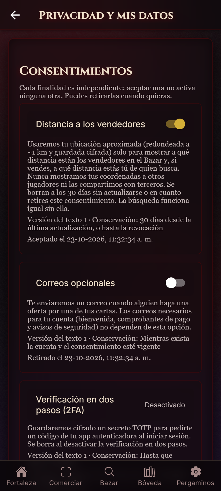
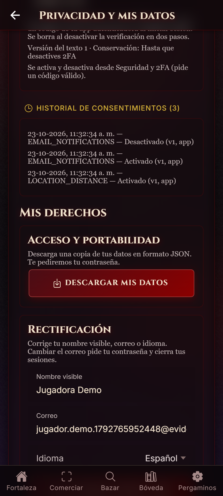
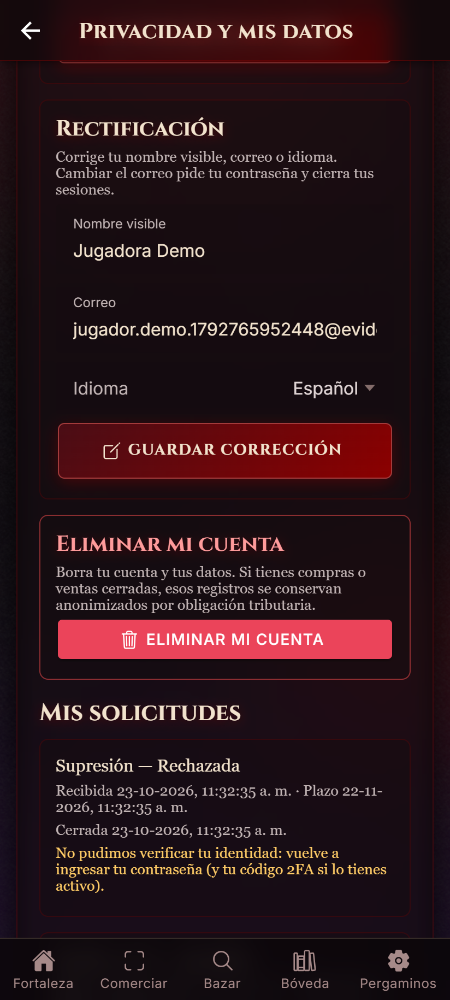
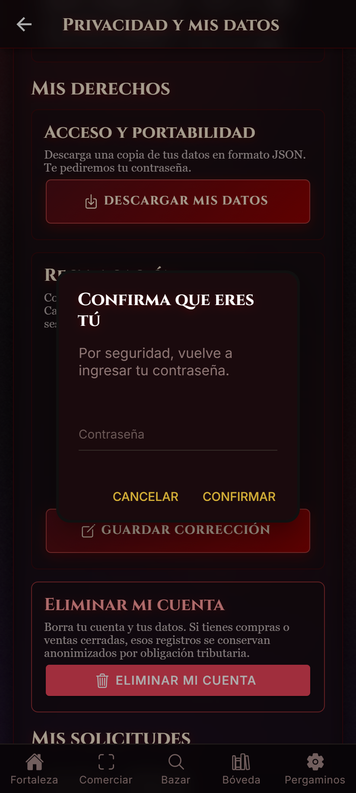
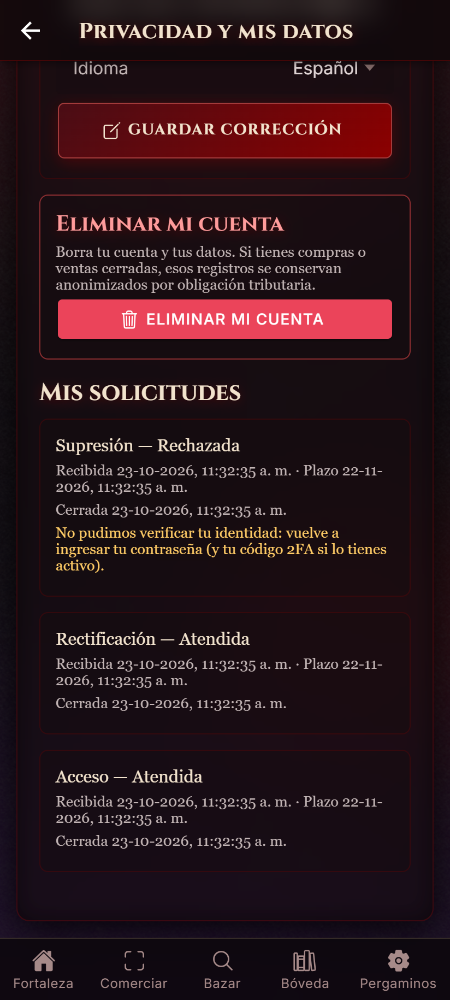

# Actividad N°5 — Gestión del consentimiento, ejercicio de derechos, auditoría y respuesta a incidentes

**Nombre:** Grupo MTG Companion  
**Integrantes:** Vicente Fuentes, Tomás Rodriguez, Tomás Solano  
**Fecha:** 23 oct 2026  
**Proyecto:** MTG Companion, una app de compraventa de cartas Magic (`apps/`), con backend NestJS + Prisma + PostgreSQL y cliente Ionic/React  
**Repositorio:** https://github.com/inzenfenix/MTGCompanion_TCG · tarea: [issue #149](https://github.com/inzenfenix/MTGCompanion_TCG/issues/149) · commit de implementación `dc645d0`  
**Insumos:** inventario y bases de licitud del Hito 1 ([`hito1/`](hito1/)) y rediseño, seudonimización y RBAC de la Actividad N°4 / Hito 2 ([`ACTIVIDAD_4.md`](ACTIVIDAD_4.md))

Los hitos anteriores dejaron cuatro deudas explícitas.

- **Ubicación:** en el Hito 1 quedó como un "consentimiento incompleto", porque llamar a la API ya contaba como aceptar.
- **Derechos sin canal:** no existía ninguna forma de pedir una copia de los datos, corregirlos o cerrar la cuenta. La Actividad N°4 lo dejó como riesgo pendiente n.º 3.
- **Auditoría limitada:** el registro de auditoría solo cubría acciones administrativas.
- **Sin procedimiento ante incidentes:** no había ninguno definido.

Esta entrega resuelve las cuatro en el código. Lo que se describe aquí está implementado y probado, y las evidencias son de ejecuciones reales (§6).

**Marco legal usado.** Se cita la Ley 19.628 en el texto que le da la **Ley 21.719**, vigente desde el **01-12-2026** según su artículo primero transitorio. Así se hizo desde el Hito 1. Todos los artículos se verificaron contra el texto publicado en la BCN.

Hasta esa fecha rige el texto anterior, cuyo art. 16 fija un plazo de **dos días hábiles** para responder. Las solicitudes que el sistema resuelve automáticamente se cierran en milisegundos (§2.2), así que cumplen ambos plazos. Las que requieran revisión manual deben responderse en dos días hábiles hasta el 30-11-2026.

---

## 1. Módulo de gestión del consentimiento

### 1.1 Qué tratamientos se basan en consentimiento, y cuáles no

El consentimiento se usa **solo** para lo opcional. Lo indispensable para el servicio se trata por contrato (art. 13 c). Pedir consentimiento para algo sin lo cual el servicio no funciona haría presumir que ese consentimiento no fue libre (art. 12).

| Finalidad (código) | Datos | Base | Por qué |
|---|---|---|---|
| `LOCATION_DISTANCE`: mostrar la distancia a los vendedores | Ubicación aproximada (~1 km, cifrada) | **Consentimiento** (arts. 12 y 16 sexies) | La búsqueda funciona sin ella. La geolocalización es una categoría especial. |
| `EMAIL_NOTIFICATIONS`: aviso "recibiste una oferta" | Correo electrónico | **Consentimiento** (art. 12) | Es un correo prescindible. Antes, `notifyByEmail` venía activado por defecto. |
| `TWO_FACTOR`: verificación en dos pasos | Secreto TOTP (cifrado) | **Consentimiento** (art. 12) | Es opcional y la cuenta funciona sin ella. |
| Cuenta, cartas, ofertas, compras, comprobantes, correos de cuenta y de seguridad | Correo, alias, contraseña (hash), transacciones | Contrato (art. 13 c) y obligación tributaria (art. 13 b) | Sin ellos no existe el servicio pedido. **No** dependen de un consentimiento. |

Las finalidades, su **texto exacto** y su **versión** están definidos en el código, en [`consent-purposes.ts`](../../apps/backend/src/consent/domain/consent-purposes.ts), y se publican en `GET /consents/purposes`. Ese endpoint no requiere sesión: el jugador tiene que poder leer el texto **antes** de decidir (consentimiento "informado"). Cambiar un texto exige subir la versión.

### 1.2 Modelo de datos

```
users 1───N consents (una fila por usuario × finalidad: estado actual)
              │  userId · purpose · version · status (GRANTED|REVOKED) · grantedAt · revokedAt · updatedAt
              │  UNIQUE (userId, purpose)
              └──1───N consent_events (historial, solo agregar)
                         action (GRANTED|REVOKED) · version · textHash (SHA-256 del texto mostrado)
                         source (app|two-factor|migration|erasure) · createdAt
```

- **`consents`** guarda el **estado actual**, que es lo que el sistema consulta al tratar los datos.
- **`consent_events`** guarda la **historia**. Sirve para que el responsable pueda *probar* que tuvo el consentimiento, carga que le impone el art. 12.
- **Protección del historial:** un trigger de la BD rechaza cualquier `UPDATE` sobre `consent_events`, así que la historia no se puede reescribir. Solo se borra en cascada cuando se elimina la cuenta (§2.5).
- **Detalle:** ver [migración `20261023180000`](../../apps/backend/prisma/migrations/20261023180000_consent_rights_audit_chain/migration.sql) y [`07_modelo_datos.txt`](evidencia/actividad5/07_modelo_datos.txt).

### 1.3 Estados, versiones y operaciones

```
          POST /consents/me/:purpose {version}              DELETE /consents/me/:purpose
 NONE ───────────────────────────────────────► GRANTED ───────────────────────────────► REVOKED
                                                  ▲                                         │
                                                  └──────────── POST (otra vez) ────────────┘
 GRANTED con versión antigua ⇒ "requiresReconsent": deja de contar hasta que se acepte el texto nuevo
```

| Operación | Endpoint | Regla |
|---|---|---|
| Registrar | `POST /consents/me/:purpose` `{version}` | El cliente envía la **versión del texto que mostró**. Si ya no es la vigente, responde 409. Se guardan la fecha y hora, la versión y el hash del texto. |
| Consultar | `GET /consents/me` · `GET /consents/me/history` | Muestra el estado por finalidad, si está vigente (`effective`), si requiere aceptarse de nuevo y el historial completo. |
| Revocar | `DELETE /consents/me/:purpose` | Se puede en cualquier momento y sin dar razones (art. 12). Se registra `revokedAt`. Es idempotente. |
| 2FA | `/auth/2fa/enable` · `/auth/2fa/disable` | `TWO_FACTOR` no se puede activar ni desactivar con una sesión sola (responde 409). Lo hace el flujo de 2FA, que exige un código válido; si no, una sesión robada podría apagar el 2FA. |

Ninguna ruta recibe un id de usuario: el titular siempre es la cuenta autenticada, así que no hay un id que se pueda manipular.

### 1.4 Cómo se refleja la revocación en los procesos que dependen del consentimiento

Hay dos mecanismos complementarios, y ambos están implementados.

1. **Compuerta al momento de usar el dato.** Todo proceso dependiente llama a `ConsentService.hasConsent(usuario, finalidad)` justo antes de actuar, nunca antes ni desde un valor cacheado. Esa función falla cerrada: si no hay fila, si está revocado o si la versión es antigua, devuelve `false`.
2. **Efecto inmediato sobre lo ya recolectado.** Se aplica en la **misma transacción** de BD que registra la revocación, de modo que no puede quedar una revocación guardada sin su efecto ni al revés ([`prisma-consent.repository.ts`](../../apps/backend/src/consent/infrastructure/prisma-consent.repository.ts)).

| Finalidad | Compuerta | Efecto al revocar |
|---|---|---|
| `LOCATION_DISTANCE` | `PATCH /users/me/location` responde **403** sin consentimiento vigente. La app no envía la ubicación si no está vigente ([`locationConsent.ts`](../../apps/mobile/src/lib/locationConsent.ts)). | Se **borran** `lastLat`, `lastLng` y `locationUpdatedAt` (no se ocultan, se borran). La búsqueda deja de calcular distancia a ese jugador. |
| `EMAIL_NOTIFICATIONS` | El listener del correo "Nueva oferta" consulta `hasConsent` **al enviar** ([`privacy.listeners.ts`](../../apps/backend/src/notifications/listeners/privacy.listeners.ts)). | Se apaga `notifyByEmail` (un espejo que solo escribe el consentimiento). Desde la siguiente oferta no se envía nada. |
| `TWO_FACTOR` | El login pide el código solo si 2FA está activo. | Se borra el secreto TOTP (lo hace el flujo de 2FA). |

La revocación **no tiene efecto retroactivo** (art. 12): un correo ya enviado no se puede retirar, y así lo dice el texto de la finalidad.

### 1.5 Cómo se evita que el consentimiento de una finalidad habilite otras

- **Una fila por finalidad** (`UNIQUE (userId, purpose)`). No existe un campo "aceptó todo" ni un consentimiento global.
- **`hasConsent` recibe la finalidad exacta.** Ningún proceso pregunta "¿consintió algo?", y el tipo `ConsentPurposeCode` impide pasar un código inventado.
- **No hay nada pre-marcado:** una cuenta nueva empieza con todo en `NONE`. Al migrar se apagó `notifyByEmail`, que antes venía en `true` por defecto, porque un valor por defecto no es un acto afirmativo. La casilla falsa "Notificaciones", siempre marcada, se reemplazó en la app por el acceso a Privacidad.
- **Un texto nuevo no se presume aceptado:** los consentimientos de ubicación anteriores a esta entrega se migraron como versión `"0"` y exigen aceptar el texto nuevo.
- **Probado:** [`consent.service.spec.ts`](../../apps/backend/src/consent/application/consent.service.spec.ts) y [`consent.e2e-spec.ts`](../../apps/backend/test/consent.e2e-spec.ts) comprueban que otorgar `LOCATION_DISTANCE` deja `EMAIL_NOTIFICATIONS` y `TWO_FACTOR` en `false`, y que tampoco afecta a otra cuenta.

### 1.6 Trazabilidad sin datos innecesarios

Cada cambio guarda **solo** lo necesario para probarlo: qué finalidad, qué versión, el SHA-256 del texto exacto mostrado, cuándo y por qué canal.

**No** se guardan la IP, el agente de usuario, el modelo del dispositivo ni la ubicación del momento. Todo eso identificaría más a la persona sin probar nada adicional, porque la sesión ya autentica a quien acepta. Además, cada cambio queda en la auditoría, seudonimizado (§3).

### 1.7 Menores de edad: flujo no aplicable

MTG Companion es un mercado con pagos reales y **solo admite mayores de 18 años**.

- **Cómo se aplica:** el registro exige la declaración "Confirmo que soy mayor de 18 años" (`adultConfirmed: true`, Actividad N°4) y guarda **cuándo** se hizo, nunca una fecha de nacimiento.
- **Por qué no hace falta un flujo propio:** ningún menor puede abrir una cuenta, así que no hay un tratamiento de datos de niños o adolescentes que requiera el consentimiento de sus padres (art. 16 quáter: bajo 14 años, siempre; datos sensibles bajo 16).
- **Si en el futuro se aceptaran menores:** habría que pedir el rango de edad, no la fecha exacta. Bajo 14 años se necesitaría un flujo de consentimiento del representante legal, con verificación por un canal separado (por ejemplo, su correo y una confirmación). La ubicación quedaría deshabilitada por defecto, porque el "interés superior" del menor manda.
- **Limitación:** la declaración es autodeclarada y no se verifica. Verificarla obligaría a pedir un documento de identidad, que es justo el dato que se quiere evitar.

### 1.8 Interfaz implementada

La nueva pantalla [`Privacy.tsx`](../../apps/mobile/src/pages/Privacy.tsx) ("Privacidad y mis datos") está accesible desde Ajustes y desde Seguridad.

- Muestra cada finalidad con su texto, versión, conservación y estado, y un interruptor propio. El 2FA aparece sin interruptor e indica dónde se gestiona.
- Incluye el historial de cambios.

| | |
|---|---|
|  |  |

---

## 2. Ejercicio de derechos

### 2.1 Verificación de identidad proporcional al riesgo

La sesión ya prueba quién pide. A eso se suma una **reautenticación** (*step-up*: `POST /auth/step-up`, con la contraseña y el código TOTP si la cuenta tiene 2FA) **solo** donde una sesión robada causaría un daño real. **Nunca** se pide un dato adicional (carnet, teléfono, selfie).

| Solicitud | Verificación | Motivo |
|---|---|---|
| Acceso / portabilidad | Sesión **+ step-up** | Entrega *todos* los datos de una vez. |
| Supresión | Sesión **+ step-up** + confirmación explícita (`confirmErasure: true`) | Es irreversible. |
| Rectificación del **correo** | Sesión **+ step-up** | Quien cambia el correo puede tomar control de la cuenta. |
| Rectificación del alias o del idioma | Sesión | Es de bajo impacto y reversible por el mismo titular. |

El token de *step-up* dura **5 minutos** y es de **un solo uso**:

- Su `jti` se guarda con restricción `UNIQUE` en la solicitud que lo consume, así que reutilizarlo falla **en la BD**.
- No sirve como token de acceso: `JwtStrategy` rechaza cualquier token con `typ`.
- Solo sirve para su titular: el de otra cuenta se rechaza.

### 2.2 Flujo de una solicitud

```
RECEPCIÓN ─► VERIFICACIÓN ─► EVALUACIÓN ─► EJECUCIÓN ─► CIERRE (FULFILLED)
   │              │               │                       │
   │              └───────────────┴──────────────────────► CIERRE (DENIED + motivo)
   └ receivedAt, dueAt = +30 días   verifiedAt     evaluatedAt    executedAt    closedAt
```

Cada solicitud es una fila de `data_rights_requests` ([`data-rights.service.ts`](../../apps/backend/src/data-rights/application/data-rights.service.ts)).

1. **Recepción.** Se crea la fila con `receivedAt` y `dueAt` = 30 días corridos (art. 11).
2. **Verificación.** Según §2.1; queda `verificationMethod`.
3. **Evaluación.** Se aplican las reglas del negocio ([`rights-policy.ts`](../../apps/backend/src/data-rights/domain/rights-policy.ts)): impedimentos para la supresión y "nada que cambiar" en la rectificación.
4. **Ejecución.** Exportación, actualización o supresión.
5. **Cierre.** Queda `FULFILLED` o `DENIED`.
   - Una denegación lleva siempre un **código de motivo y un mensaje** (art. 11: la denegación debe ser fundada).
   - Al cerrar, se envía la **respuesta por escrito** al correo del titular. Si fue denegada, indica que puede reclamar ante la Agencia dentro de 30 días hábiles.
   - En una supresión, el correo se toma **antes** de borrar.

**Seguimiento.** El titular ve sus solicitudes en `GET /data-rights/requests`. SUPPORT y ADMIN ven los plazos en `GET /admin/data-rights/requests` (permiso nuevo `DATA_REQUESTS_READ`), con el sujeto **seudonimizado**, sin contenidos y con una marca `overdue`.

La fila **no** tiene FK hacia `users`: así sobrevive a la supresión de la cuenta como prueba de que se respondió, sin apuntar a nadie.

### 2.3 Acceso y portabilidad

- **Cómo se pide:** `POST /data-rights/requests {type: "ACCESS", stepUpToken}`.
- **Formato:** JSON (`format: "mtg-companion/personal-data-export"`, `version: 1`). Es el "formato electrónico estructurado, genérico y de uso común" del art. 9 y lo puede leer cualquier lenguaje. La app lo descarga como archivo.
- **Contenido:** cuenta, ajustes (incluida su propia ubicación descifrada, si la compartía), consentimientos y su historial, cartas, mazos, ofertas hechas, transacciones, cupones y solicitudes anteriores.
- **Información de tratamiento:** incluye `processing`, con la finalidad, la base, los destinatarios y la conservación de cada categoría, que el art. 5 también da derecho a conocer.
- **Exclusiones declaradas:** incluye `notIncluded`, la lista de lo que se excluye a propósito y por qué.

| Excluido | Motivo |
|---|---|
| Hash de contraseña, secreto 2FA, tokens | Son credenciales y no datos portables. Entregarlas solo crea otra copia que alguien podría robar. |
| Id, correo y ofertas de **otros** jugadores | Son datos de terceros. De la contraparte solo va el alias público que la app ya muestra. |
| Registro de auditoría y alertas | Son registros de seguridad seudonimizados; entregarlos revelaría cómo se detecta el abuso. Se puede pedir información específica por escrito. |
| `paymentRef` | Es un identificador interno del proveedor de pagos. |

La exportación se arma, se entrega **una sola vez** y **no se guarda**: la solicitud registra solo los nombres de las secciones.

### 2.4 Rectificación

- **Cómo se pide:** `POST /data-rights/requests {type: "RECTIFICATION", rectification: {displayName?, email?, language?}}`.
- **Validaciones:** son las **mismas que en el registro** (`RectificationDto`): alias de 1 a 40 caracteres sin datos de contacto, correo válido e idioma permitido. Cualquier otro campo (por ejemplo, `role`) se rechaza con 400, así que una corrección no puede colar un valor que el sistema habría rechazado al registrarse.
- **Reglas que necesitan la BD:** el correo debe ser único (si no, se deniega con `EMAIL_IN_USE`). Al cambiarlo:
  - se borra la verificación del correo;
  - se **revocan todas las sesiones**;
  - se **avisa a la dirección anterior** por si el cambio no lo hizo el titular.
- **Trazabilidad:** la auditoría guarda **qué campos** cambiaron (`reason: "displayName"`), **nunca** los valores anteriores ni los nuevos.
- **Propagación a otros módulos** (art. 6):
  - El alias se lee por relación en cada consulta (publicaciones, transacciones, exportación de la contraparte), así que no hay copias que actualizar. Está verificado en la evidencia: la contraparte ve el nombre nuevo.
  - El correo se lee en el momento de enviar comprobantes y avisos.
  - Los tokens de acceso ya emitidos llevan el correo antiguo; por eso se revocan.
  - El sistema no cede datos a terceros, salvo el envío de correos; no hay destinatarios externos a quienes comunicar la rectificación.

### 2.5 Supresión

- **Cómo se pide:** `POST /data-rights/requests {type: "ERASURE", confirmErasure: true, stepUpToken}`.

**Cuándo no procede de inmediato.** La regla es la del art. 7 ("no procede la supresión cuando el tratamiento sea necesario… para la ejecución de un contrato"). La denegación es temporal y explica por qué:

| Impedimento | Código |
|---|---|
| Una compra o venta en estado `PENDING`: la contraparte espera una carta o un pago | `OPEN_TRANSACTIONS` |
| Una subasta activa en la que vende o va ganando: hay una oferta vinculante en curso | `ACTIVE_AUCTION` |
| Rol SUPPORT o ADMIN: otro ADMIN debe quitárselo antes, para que nadie use la supresión para borrar su rastro como personal | `ADMIN_ROLE` |

**Qué se borra y qué se conserva** (en una sola transacción de BD, [`prisma-data-rights.repository.ts`](../../apps/backend/src/data-rights/infrastructure/prisma-data-rights.repository.ts)):

| | Sin transacciones | Con transacciones cerradas |
|---|---|---|
| Cuenta (`users`) | **Se borra la fila** (cascada) | Queda una **lápida anónima**: correo `erased-<uuid>@erased.invalid`, alias "Cuenta eliminada", contraseña inutilizable, `deletedAt`. |
| Ajustes, ubicación, 2FA, sesiones, consentimientos y su historial | Se borran | Se borran |
| Cartas sin venta, sus fotos (BD y bucket), mazos, ofertas, cupones no usados | Se borran | Se borran |
| Cartas vendidas, cupones usados, transacciones | (no hay) | **Se conservan** sin la descripción libre, para los comprobantes y la obligación tributaria de 6 años (Código Tributario, arts. 17 y 200; art. 7 ii). |
| Registro de auditoría | Se conserva **seudonimizado**, sin vínculo directo a la persona, hasta su plazo (§3.6) | Igual |
| La solicitud misma | Se conserva como prueba de respuesta | Se conserva |

**Copias, registros y sistemas relacionados.**

- **Fotos (bucket S3/MinIO):** se borran después de confirmar la transacción. Si alguna falla, se cuenta (`storageObjectsPendingDeletion`) en vez de revertir lo ya borrado.
- **Respaldos de BD:** no se editan; los datos borrados expiran con su ciclo de rotación. Si se restaura un respaldo, hay que volver a aplicar las supresiones registradas en `data_rights_requests` antes de reabrir el servicio. Este paso está incluido en la recuperación del plan (§4.d).
- **Logs de aplicación:** ya no contienen correos (Actividad N°4).

**Para que lo borrado no se vuelva a usar:**

- La cuenta queda sin sesiones: `findAuthContext` devuelve `null` para `deletedAt` y el login falla.
- No queda ubicación ni consentimientos.
- La contraparte ve "Cuenta eliminada".

### 2.6 No son "botones sin validaciones"

Cada operación pasa por autorización (sesión y, cuando corresponde, *step-up*), reglas de negocio (DTO + `rights-policy.ts`), registro de estado y auditoría. Todas se probaron por la API real, incluidos los intentos de saltarlas (§5.3). La interfaz:

| | | |
|---|---|---|
|  |  |  |

---

## 3. Registro de auditoría

Este registro amplía el `audit_logs` seudonimizado de la Actividad N°4. Ahora cubre **todas** las operaciones relevantes sobre datos personales y se puede **verificar que nadie lo alteró**.

### 3.1 Eventos registrados

| Categoría | `action` |
|---|---|
| Autenticación | `auth.login` (correcto, fallido, bloqueado; con motivo: `bad-password`, `unknown-email`, `locked`, `disabled`), `auth.2fa`, `auth.step-up` |
| Consentimiento | `consent.grant`, `consent.revoke` |
| Derechos | `data.export`, `data.rectify`, `data.erase` (aceptados y denegados, con su código) |
| Acceso a información de otros | `support.transactions.read` (con motivo obligatorio), `admin.pseudonym.resolve` |
| Acciones administrativas | `admin.role.change`, `admin.audit.read`, `admin.audit.verify`, `admin.reports.sales.read`, `admin.data-rights.list` |
| Denegaciones de permiso | `denied <MÉTODO> <ruta>` |
| Seguridad | `security.alert.raised`, `security.alert.update`, `security.containment.lock`, `security.containment.revoke-sessions`, `security.containment.disable`, `security.recovery.enable`, `security.containment.revoke-all-sessions`, `incident.snapshot`, `audit.retention.purge` |

### 3.2 Atributos de cada registro

| Atributo | Contenido |
|---|---|
| `id`, `seq` | Identificador del evento y número secuencial (orden total). |
| `createdAt` | Fecha y hora (UTC, en milisegundos). |
| `actorPseudonym`, `actorRole` | Quién: un seudónimo HMAC (`u_…`), `system` o `anonymous`, y su rol en ese momento. |
| `action` | Qué operación. |
| `targetPseudonym` | A quién afecta (seudónimo). |
| `resourceType`, `resourceRef` | Sobre qué recurso: un id interno (solicitud, alerta) o un código (finalidad), **nunca** una copia del dato. |
| `reason` | El motivo declarado o el código del resultado (`bad-password`, `OPEN_TRANSACTIONS`, nombres de campos). |
| `outcome` | `ALLOWED`, `DENIED` o `FAILED`. |
| `prevHash`, `hash` | El eslabón de la cadena de integridad (§3.4). |

### 3.3 Información que NO se registra

- Contraseñas, ni siquiera las fallidas, ni sus hashes.
- Tokens de acceso, de refresco, de 2FA o de *step-up*.
- Llaves criptográficas, secretos TOTP y valores cifrados.
- El id real de un usuario, su correo, su alias o su ubicación. Solo se guarda el seudónimo.
- El correo tecleado en un login fallido: si la cuenta no existe, el actor es `anonymous` y no queda rastro del correo.
- Los **valores** de una rectificación (solo los nombres de los campos) y el contenido de una exportación.
- IP o agente de usuario: la detección trabaja por seudónimo (§4.b).

Esto se hace cumplir en **un solo lugar**, [`AuditService.record`](../../apps/backend/src/common/audit/audit.service.ts). Ahí se seudonimiza, y además el `reason` pasa por `redactPersonalData`, que enmascara correos y elimina JWT y números de teléfono que se hubieran colado. Hay una prueba unitaria de esto ([`audit.service.spec.ts`](../../apps/backend/src/common/audit/audit.service.spec.ts)). La evidencia lo comprueba sobre las 61 filas reales: ningún `@`, ningún id real, ningún JWT ni contraseña.

### 3.4 Protección contra modificación, acceso indebido y eliminación

1. **Trigger "solo agregar"** (Actividad N°4, endurecido): `UPDATE` y `TRUNCATE` se rechazan para **cualquier** conexión, incluido el dueño de la tabla. `DELETE` solo pasa si se cumplen las dos condiciones de §3.6.
2. **Cadena de hash con llave.** Cada fila guarda `hash = HMAC-SHA256(llave, hash_anterior ␟ campos)` ([`audit-chain.ts`](../../apps/backend/src/common/audit/audit-chain.ts)). La escritura se serializa con `pg_advisory_xact_lock`.
   - **Qué detecta:** si alguien desactiva el trigger (solo el dueño puede) y edita, borra o inserta una fila, la cadena se rompe en ese punto.
   - **Por qué no se puede rehacer:** recalcularla exige la llave. Esta se deriva de `PSEUDONYM_KEY` con HKDF y vive solo en el proceso del backend, no en la BD.
   - **Cómo se verifica:** `GET /admin/security/audit/verify` o `incident-snapshot`. Una cadena rota **levanta una alerta** `audit.chain.broken`. Está demostrado en la evidencia: se editó una fila y la verificación marcó `brokenAt: seq 30`.
3. **Mínimo privilegio en la BD** ([`least-privilege-role.sql`](../../apps/backend/prisma/sql/least-privilege-role.sql)): el rol de la API (`mtg_app`) no tiene `UPDATE` ni `DELETE` sobre `audit_logs` y `consent_events`, ni `DELETE` sobre `data_rights_requests` y `security_alerts`. Se probó en la e2e.
4. **Acceso de lectura** solo por la API, con permiso (§3.5). No hay ningún endpoint para editar o borrar registros.

### 3.5 Quién puede consultar

| Rol | Auditoría (`GET /admin/audit-logs`, `…/audit/verify`) | Alertas y contención | Seguimiento de solicitudes |
|---|---|---|---|
| USER | ✗ (403, y el intento queda auditado) | ✗ | Solo las propias |
| SUPPORT | ✗ | ✗ | ✓ (seudonimizado) |
| ADMIN | ✓ (leerla también se audita) | ✓ | ✓ |

Ver un registro no identifica a nadie. Re-identificar un seudónimo exige `POST /admin/pseudonyms/resolve`, que solo puede usar ADMIN, requiere un motivo y queda auditado (Actividad N°4).

### 3.6 Conservación y eliminación segura

**Plazo:** **730 días** (`AUDIT_RETENTION_DAYS`), con un **mínimo de 365** que impone el propio trigger. Es una decisión de política, no un plazo legal:

- es suficiente para investigar incidentes detectados tarde y para atender reclamos ante la Agencia;
- es más corto que los 6 años tributarios, porque la auditoría no es un registro contable.

**Eliminación:** solo la hace [`purge-expired-data`](../../apps/backend/src/scripts/purge-expired-data.ts), que corre en cada arranque del contenedor como dueño de la BD.

- Activa una marca **local a su transacción** (`set_config('app.audit_retention_purge','on', true)`).
- El trigger exige esa marca **y** que la fila sea más antigua que el plazo, así que un error o una credencial robada no pueden borrar evidencia reciente. Está demostrado: con la marca, pero sobre filas de hoy, la BD rechaza el borrado.
- La purga queda registrada en la propia cadena (`audit.retention.purge`), por lo que el nuevo primer eslabón queda explicado.
- Con el mismo plazo se purgan las solicitudes cerradas y las alertas cerradas o descartadas.

### 3.7 Equilibrio entre trazabilidad, investigación y minimización

- **Seudónimo estable por actor:** permite seguir a un actor a lo largo de todo el registro (patrones de fuerza bruta, sondeos, uso del soporte) sin saber quién es. Identificarlo es un paso separado, excepcional y auditado.
- **Referencias en vez de copias:** el *qué* se guarda como referencia (id de solicitud, código de finalidad, nombres de campos). Para investigar basta con eso, y el dato personal sigue en un solo lugar, donde se puede borrar.
- **Por qué no se guarda la IP:** sería útil contra ataques distribuidos, pero es un dato personal más y casi siempre identifica. La defensa contra ataques desde muchas IP queda para la capa de red (§7, limitaciones).

### 3.8 Ejemplos de eventos generados en operaciones reales de prueba

Este es un extracto de [`05_eventos_auditoria.txt`](evidencia/actividad5/05_eventos_auditoria.txt), generado por el backend compilado contra PostgreSQL 16:

```
seq hora          actor               rol     action                          objetivo            ref                 reason                   outcome
 2  14:28:22.511  u_14577fde050acb8b  USER    consent.grant                   —                   LOCATION_DISTANCE   v1 via app               ALLOWED
 9  14:28:26.441  u_14577fde050acb8b  USER    data.export                     u_14577fde050acb8b  ff67a629-04c7-4c77  —                        ALLOWED
10  14:28:26.525  u_14577fde050acb8b  USER    data.export                     u_14577fde050acb8b  49858f22-e0f7-4af0  STEP_UP_REUSED           DENIED
14  14:28:27.467  u_14577fde050acb8b  USER    data.rectify                    u_14577fde050acb8b  cda77d4f-5ace-4860  email                    ALLOWED
18  14:28:31.921  u_a51ca162e6320f9f  USER    data.erase                      u_a51ca162e6320f9f  4667fa1a-c99c-4ee0  OPEN_TRANSACTIONS        DENIED
24  14:28:36.316  anonymous           —       auth.login                      —                   —                   unknown-email            DENIED
34  14:28:45.386  u_ae0365ff1728b86f  USER    auth.login                      —                   —                   bad-password             FAILED
35  14:28:45.413  system              —       security.alert.raised           u_ae0365ff1728b86f  c4434550-7801-4ecc  auth.bruteforce (HIGH)   ALLOWED
36  14:28:45.426  system              —       security.containment.lock       u_ae0365ff1728b86f  c4434550-7801-4ecc  —                        ALLOWED
54  14:28:51.771  u_e0be39860446ca40  ADMIN   security.containment.disable    u_ae0365ff1728b86f  —                   INC-1: cuenta bajo ata…  ALLOWED
```

---

## 4. Plan de respuesta a incidentes

**Alcance.** Cubre los datos personales tratados por MTG Companion: cuentas, transacciones, ubicación cifrada, secretos 2FA cifrados, fotos de cartas y registros. También la infraestructura que los contiene: backend y PostgreSQL en EC2, bucket S3 de fotos, AWS Secrets Manager con `JWT_SECRET`, `FIELD_ENCRYPTION_KEY` y `PSEUDONYM_KEY`, y el repositorio de código.

**Riesgos priorizados**, del análisis CIA y de los hitos:

1. Toma de cuentas por credenciales robadas o fuerza bruta.
2. Filtración de la BD o de un respaldo.
3. Filtración de llaves o secretos.
4. Abuso de acceso interno por parte del soporte.
5. Manipulación de registros para ocultar un acceso.
6. Exposición por falta de TLS (riesgo abierto, O5).

### Responsables por fase

| Rol | Responsable (propuesta del grupo) | Responsabilidades |
|---|---|---|
| **Responsable de seguridad / líder del incidente** | Vicente Fuentes | Clasifica, decide el escalamiento, coordina las fases y cierra el caso. Autoriza la contención mayor. |
| **Desarrollo** | Tomás Rodriguez | Analiza la causa en el código, desarrolla y prueba la corrección y revisa la auditoría. |
| **Administración del sistema** | Tomás Solano | Ejecuta la contención técnica (scripts, rotación de secretos, aislamiento en AWS), los respaldos y la restauración. |
| **Comunicación** | Vicente Fuentes (líder) con apoyo de Tomás Solano | Redacta las notificaciones a la Agencia y a los titulares, y es el canal de contacto. |
| **Aprobación de las comunicaciones** | Líder del incidente + un segundo integrante | Ninguna notificación externa sale con una sola firma. |

Cada fase tiene un responsable principal y un suplente (el integrante siguiente de la tabla), para que el plan no dependa de una sola persona.

### a. Preparación

**Canales de reporte**

| Canal | Quién lo usa |
|---|---|
| Correo de seguridad (`SECURITY_ALERT_EMAIL`): **cada alerta automática lo avisa** | Sistema y titulares |
| *Security advisory* privado en GitHub | Investigadores y el equipo |
| Respuesta al correo de "tu correo cambió" o de respuesta de una solicitud | Titulares |
| Canal interno del grupo | Avisos rápidos entre los responsables |

**Recursos técnicos y procedimientos, ya implementados**

| Recurso | Para qué |
|---|---|
| `GET /admin/security/alerts`, `PATCH /admin/security/alerts/:id` | Ver y clasificar las alertas. |
| `GET /admin/security/audit/verify` | Comprobar que el registro está íntegro. |
| `npm run incident:snapshot -- --out <dir>` | Preservar la evidencia con un manifiesto SHA-256. |
| `POST /admin/security/users/:id/revoke-sessions` · `/disable` · `/enable` | Contener o recuperar una cuenta. |
| `npm run incident:revoke-all-sessions -- --confirm` | Cerrar todas las sesiones. |
| `POST /admin/pseudonyms/resolve` (con motivo) | Identificar al titular afectado cuando haya que notificarle. |
| Secrets Manager + `deploy-backend.sh` | Rotar llaves y secretos. |
| Respaldos de PostgreSQL y snapshots EBS | Restaurar. |

**Preparación continua:** revisar las alertas abiertas cada semana, verificar la cadena de auditoría después de cada despliegue y ensayar este plan una vez por semestre con un caso simulado. La evidencia [`06_deteccion_contencion.txt`](evidencia/actividad5/06_deteccion_contencion.txt) es un ensayo de ese tipo.

### b. Detección y análisis

**Criterios de detección.** Las reglas se evalúan sobre cada evento de auditoría ([`detection-rules.ts`](../../apps/backend/src/security/domain/detection-rules.ts)):

| Regla | Criterio | Severidad | Contención automática |
|---|---|---|---|
| `auth.bruteforce` | ≥ 5 contraseñas incorrectas contra la misma cuenta en 15 min | ALTA | **Bloqueo de la cuenta por 15 min**; la respuesta sigue siendo el mismo 401 genérico |
| `auth.credential-stuffing` | ≥ 20 logins con correos inexistentes en 5 min | ALTA | — (capa de red) |
| `auth.step-up.failures` | ≥ 3 reautenticaciones fallidas desde una sesión válida en 15 min | ALTA | **Revocar todas las sesiones** de la cuenta (probable sesión robada) |
| `data.export.burst` | ≥ 3 exportaciones completas de la misma cuenta en 24 h | MEDIA | — |
| `support.read.burst` | ≥ 20 consultas del soporte a cuentas ajenas en 1 h | MEDIA | — |
| `access.denied.burst` | ≥ 5 intentos denegados a rutas de administración en 10 min | MEDIA | — |
| `audit.chain.broken` | La verificación de la cadena falla | ALTA | — (se pasa directo a análisis) |

**Por reporte.** Una notificación de un titular o de un tercero, un secreto encontrado en el repositorio o en un log, o un comportamiento anómalo observado por el equipo, se registra a mano como alerta y se analiza igual.

**Tres niveles.** Corresponden a los estados de `security_alerts`, y cada transición exige una nota y queda auditada:

| Nivel | Estado | Significado | Quién decide |
|---|---|---|---|
| **Alerta** | `OPEN` | Una regla o un reporte la generó; todavía nadie la revisó. | Automático |
| **Evento sospechoso** | `INVESTIGATING` | Un humano la revisó y hay indicios reales; se analiza. | ADMIN de turno |
| **Incidente confirmado** | `CONFIRMED` | Hay evidencia de que se comprometió la confidencialidad, integridad o disponibilidad de datos personales. **Se activa este plan completo.** | Líder del incidente |
| Falso positivo | `DISMISSED` | Se descarta con justificación. | ADMIN de turno |

Una alerta no puede pasar directo a `CLOSED`: el sistema obliga a analizarla primero (409).

**Evaluación de alcance, gravedad e impacto**

| Pregunta | Fuente |
|---|---|
| ¿Qué cuentas? | Seudónimos en `audit_logs` y `security_alerts`. Se identifican con `resolve` solo si hay que notificar. |
| ¿Qué datos? | Las categorías del inventario del Hito 1 tocadas por las acciones registradas. |
| ¿Desde cuándo? | El primer evento anómalo en la cadena verificada. |
| ¿Hubo acceso real o solo intentos? | `outcome` ALLOWED frente a DENIED o FAILED. |

| Gravedad | Criterio | Escalamiento |
|---|---|---|
| **Baja** | Intentos sin éxito, sin acceso a datos | Responsable de turno; se cierra en ≤ 7 días |
| **Media** | Acceso indebido a datos de pocas cuentas, sin datos financieros, de ubicación ni credenciales | Líder del incidente en < 24 h |
| **Alta** | Acceso o filtración de credenciales o llaves, de transacciones, de ubicación, de muchas cuentas, o un registro manipulado | Todo el equipo **de inmediato**; se evalúa la notificación (fase e) |

### c. Contención

Las acciones van de menor a mayor impacto. Todas son reversibles y todas se auditan.

| Acción | Cuándo | Cómo |
|---|---|---|
| Bloqueo temporal de la cuenta | Fuerza bruta | Automático (15 min) |
| Revocar sesiones de una cuenta | Token robado o sesión sospechosa | `POST /admin/security/users/:id/revoke-sessions`: borra los *refresh tokens* y **también invalida los tokens de acceso vigentes** (`sessionsRevokedAt` comparado con el `iat`) |
| Deshabilitar una cuenta | Cuenta comprometida o usada para atacar | `POST /admin/security/users/:id/disable`: no hay login, refresh ni token que valga |
| Restringir permisos | Abuso de un rol de personal | `PATCH /admin/users/:id/role` → USER (lo hace otro ADMIN; no se puede cambiar el rol propio) |
| Revocar **todas** las sesiones | `JWT_SECRET` filtrado o volcado de BD con hashes de tokens | `npm run incident:revoke-all-sessions -- --confirm` **y** rotar `JWT_SECRET` |
| Aislar un componente | Compromiso de la EC2 o del bucket | Quitar las reglas de entrada del *security group*, detener la instancia (sin terminarla), revocar las políticas del bucket |

**Cómo no destruir evidencia**

1. **Primero preservar.** `incident:snapshot` copia la auditoría y las alertas con un manifiesto SHA-256, verifica la cadena y deja constancia en el propio registro. El hash del manifiesto se anota en la ficha del incidente. Luego se toma un snapshot EBS de la BD.
2. **Contener sin borrar.** Las acciones deshabilitan y revocan; ninguna elimina cuentas ni registros. El trigger impide borrar la auditoría.
3. **No reiniciar ni terminar** instancias comprometidas antes del snapshot.
4. **Anotar cada paso** en la ficha del incidente, con hora y autor. Las acciones de la API ya quedan en la auditoría.

### d. Erradicación y recuperación

**Erradicación:** identificar la causa raíz a partir de la auditoría y el código, y corregirla.

- Parchar la vulnerabilidad, con una prueba e2e que reproduzca el ataque.
- Rotar las llaves y secretos expuestos: `FIELD_ENCRYPTION_KEY` con su procedimiento de rotación (`encrypt-existing-fields --rotate`), `JWT_SECRET`, `PSEUDONYM_KEY` y las credenciales de AWS y de BD.
- Eliminar los accesos creados por el atacante.

**Recuperación:** desplegar la corrección y rehabilitar las cuentas (`/enable` levanta el bloqueo y la deshabilitación), forzando un cambio de contraseña cuando corresponda. Si se restaura un respaldo, **volver a aplicar las supresiones** registradas en `data_rights_requests` después de la fecha del respaldo.

**Comprobaciones antes de restablecer el servicio**

- [ ] La corrección pasa la suite completa (unitarias + e2e) y la prueba nueva que reproduce el ataque.
- [ ] `GET /admin/security/audit/verify` → `ok: true`.
- [ ] No quedan alertas `OPEN` o `INVESTIGATING` relacionadas.
- [ ] Los secretos se rotaron y las sesiones anteriores se invalidaron.
- [ ] `docker-entrypoint.sh` completó las migraciones, el recifrado y la retención sin errores.
- [ ] Hay un monitoreo reforzado de las reglas implicadas durante 7 días.

### e. Notificación y comunicación

**Criterios** (Ley 19.628, art. 14 sexies, texto vigente desde el 01-12-2026):

| Destinatario | Cuándo corresponde | Plazo |
|---|---|---|
| **Agencia de Protección de Datos Personales** | Toda vulneración de seguridad que cause destrucción, filtración, pérdida o alteración de datos personales, o acceso no autorizado a ellos, **cuando exista un riesgo razonable** para los derechos de los titulares | "Por los medios más expeditos posibles y **sin dilaciones indebidas**". La ley **no** fija un número de horas. |
| **Titulares afectados** | Cuando la vulneración afecte datos sensibles, datos de menores de 14 años o **datos relativos a obligaciones de carácter económico, financiero, bancario o comercial**. En este sistema, las **transacciones** (compras, ventas, montos) caen en esa última categoría. | Igual, sin dilaciones indebidas. Si no es posible a cada uno, mediante un aviso en un medio masivo de alcance nacional. |
| Proveedores (AWS, MercadoPago) | Si el incidente toca su servicio o requiere su acción | Según sus contratos |
| Policía de Investigaciones / Fiscalía | Si hay un delito informático (Ley 21.459) | — |

**Plazo interno.** Como la ley no fija un plazo universal, el equipo se obliga a una evaluación inicial en ≤ 24 h desde que el incidente se confirma. Si corresponde notificar, la comunicación a la Agencia sale en ≤ 72 h desde la confirmación, aunque esté incompleta, y se complementa después. Las 72 h se toman del RGPD (art. 33) como **referencia de buena práctica, no como obligación chilena**.

**Ley 21.663 (Marco de Ciberseguridad).** Exige reportes en 3 horas, pero solo a servicios esenciales y operadores de importancia vital, calidad que este sistema **no** tiene. No aplica.

**Registro de comunicaciones.** El art. 14 sexies obliga a registrarlas, con la naturaleza de la vulneración, sus efectos, las categorías de datos, el número aproximado de titulares y las medidas adoptadas. Se registran en la ficha del incidente, junto a la alerta `CONFIRMED`.

**Quién evalúa y autoriza.** El líder del incidente evalúa si existe "riesgo razonable", con el análisis de la fase b. La comunicación la redacta el rol de Comunicación y la **aprueban dos integrantes**.

**Contenido mínimo de la notificación** (plantilla):

> **Asunto:** Aviso de incidente de seguridad en MTG Companion
>
> 1. **Qué pasó:** [descripción clara, en lenguaje sencillo].
> 2. **Cuándo:** detectado el [fecha]; ocurrió entre [inicio] y [fin] (o "en investigación").
> 3. **Qué datos tuyos pueden estar afectados:** [categorías concretas: correo, historial de compras, etc.].
> 4. **Qué podría significar para ti:** [posibles consecuencias: phishing dirigido, uso de tu cuenta, etc.].
> 5. **Qué hicimos:** [contención y mitigación: sesiones cerradas, claves rotadas, vulnerabilidad corregida].
> 6. **Qué te recomendamos:** cambiar tu contraseña (y donde la reutilices), activar 2FA, desconfiar de correos que pidan datos.
> 7. **Contacto:** [correo de seguridad], con el n.º de incidente [INC-n] para consultas y seguimiento.

### f. Lecciones aprendidas

En los 14 días siguientes al cierre, el equipo hace una revisión **sin culpables** y deja en la ficha del incidente:

1. **Causa:** técnica y organizativa. Línea de tiempo reconstruida desde la auditoría verificada.
2. **Medidas correctivas** (lo que se arregló) y **preventivas** (lo que evita que se repita), cada una como fila de `ROADMAP.md` con responsable.
3. **Mejoras de controles, procedimientos y detección:** ajustar umbrales (incluidos los falsos positivos), nuevas reglas en `detection-rules.ts` y cambios a este plan.

**Condiciones para cerrar el caso** (alerta → `CLOSED`):

- causa erradicada;
- comprobaciones de la fase d cumplidas;
- notificaciones enviadas y registradas, o la decisión fundada de no notificar;
- revisión de lecciones aprendidas hecha.

---

## 5. Implementación en el código

### 5.1 Archivos

| Archivo | Qué hace |
|---|---|
| [`schema.prisma`](../../apps/backend/prisma/schema.prisma), [migración `20261023180000`](../../apps/backend/prisma/migrations/20261023180000_consent_rights_audit_chain/migration.sql) | Tablas `consents`, `consent_events`, `data_rights_requests` y `security_alerts`; columnas nuevas de `audit_logs` y de estado de cuenta en `users`; triggers; migración de los consentimientos anteriores. |
| [`consent/`](../../apps/backend/src/consent/) | Catálogo de finalidades versionado, `ConsentService.hasConsent`, endpoints y efectos de la revocación en la misma transacción. |
| [`data-rights/`](../../apps/backend/src/data-rights/) | Flujo de solicitudes, reglas ([`rights-policy.ts`](../../apps/backend/src/data-rights/domain/rights-policy.ts)), exportación, supresión o lápida, y seguimiento para el personal. |
| [`auth/application/auth.service.ts`](../../apps/backend/src/auth/application/auth.service.ts), [`jwt.strategy.ts`](../../apps/backend/src/auth/presentation/jwt.strategy.ts) | Login auditado y con bloqueo, *step-up* de un solo uso, rechazo de tokens anteriores a `sessionsRevokedAt` y de cuentas deshabilitadas o borradas. |
| [`common/audit/audit-chain.ts`](../../apps/backend/src/common/audit/audit-chain.ts), [`audit.service.ts`](../../apps/backend/src/common/audit/audit.service.ts) | Cadena HMAC, escritura serializada, redacción del `reason`, verificación y entrega de cada evento a la detección. |
| [`security/`](../../apps/backend/src/security/) | Reglas de detección, alertas y su ciclo de vida, contención y recuperación. |
| [`users/application/users.service.ts`](../../apps/backend/src/users/application/users.service.ts) | Compuerta de ubicación, consentimiento 2FA, rectificación y estado de cuenta. |
| [`notifications/`](../../apps/backend/src/notifications/) | Respuesta escrita a las solicitudes, aviso de cambio de correo, alerta al buzón de seguridad y correo opcional condicionado al consentimiento. |
| [`common/auth/permissions.ts`](../../apps/backend/src/common/auth/permissions.ts) | Permisos `DATA_REQUESTS_READ` (SUPPORT, ADMIN) e `INCIDENT_RESPONSE` (ADMIN). |
| [`scripts/purge-expired-data.ts`](../../apps/backend/src/scripts/purge-expired-data.ts), [`incident-snapshot.ts`](../../apps/backend/src/scripts/incident-snapshot.ts), [`revoke-all-sessions.ts`](../../apps/backend/src/scripts/revoke-all-sessions.ts) | Retención, preservación de evidencia y contención global. |
| [`least-privilege-role.sql`](../../apps/backend/prisma/sql/least-privilege-role.sql) | Privilegios del rol `mtg_app` sobre las tablas nuevas. |
| App: [`Privacy.tsx`](../../apps/mobile/src/pages/Privacy.tsx), [`api.ts`](../../apps/mobile/src/lib/api.ts), [`locationConsent.ts`](../../apps/mobile/src/lib/locationConsent.ts), [`TabSearch.tsx`](../../apps/mobile/src/pages/TabSearch.tsx), [`Tab4.tsx`](../../apps/mobile/src/pages/Tab4.tsx) | Pantalla de privacidad y derechos; la ubicación solo se envía con consentimiento vigente. |

**Fragmentos clave**

```ts
// consent/application/consent.service.ts — la única pregunta que hacen los procesos
async hasConsent(userId: string, purpose: ConsentPurposeCode): Promise<boolean> {
  const row = await this.consents.find(userId, purpose);
  return row?.status === 'GRANTED' && row.version === CONSENT_PURPOSES[purpose].version;
}

// users/application/users.service.ts — la compuerta, justo antes de guardar
if (!(await this.consent.hasConsent(userId, 'LOCATION_DISTANCE'))) {
  throw new ForbiddenException('Location consent required (POST /consents/me/LOCATION_DISTANCE)');
}

// auth/presentation/jwt.strategy.ts — contención efectiva sobre tokens ya emitidos
if (user.sessionsRevokedAt && (payload.iat ?? 0) < Math.floor(user.sessionsRevokedAt.getTime() / 1000)) {
  throw new UnauthorizedException('Invalid token');
}
```

```sql
-- migración 20261023180000 — retención: solo con la marca de la tarea y solo filas antiguas (mínimo 365 días)
IF TG_OP = 'DELETE'
   AND current_setting('app.audit_retention_purge', true) = 'on'
   AND OLD."createdAt" < (CURRENT_TIMESTAMP - make_interval(days => retention_days)) THEN
  RETURN OLD;
END IF;
RAISE EXCEPTION 'audit_logs is append-only (% rejected)', TG_OP;
```

### 5.2 Justificación de las decisiones de implementación

- **Estado + eventos en vez de una sola tabla.** Consultar "¿hay consentimiento?" es una búsqueda por clave única (rápida y sin ambigüedad), mientras que la prueba histórica es un registro aparte, inmutable y protegido por la BD.
- **Finalidades en código, no en una tabla.** Un cambio de texto pasa por revisión de código y sube la versión. Una tabla editable permitiría cambiar lo que el jugador "aceptó" sin dejar rastro. El hash del texto en cada evento prueba qué se mostró.
- **Efecto de la revocación en la misma transacción.** No puede existir una revocación registrada con la ubicación todavía guardada.
- **Step-up con `jti` único en BD**, en vez de una lista en memoria: el uso único resiste reinicios y varias instancias, y no necesita otra tabla.
- **Lápida en vez de borrar todo.** Las transacciones tienen una FK hacia el usuario y una obligación de conservación de 6 años. Anonimizar la fila cumple ambas sin dejar datos que identifiquen.
- **Cadena HMAC con llave derivada (HKDF).** Una cadena sin llave podría recalcularse tras manipularla. Derivar la llave evita agregar otro secreto al despliegue, sin reutilizar los mismos bytes para dos fines.
- **Detección sobre la auditoría.** Las reglas reutilizan el registro seudonimizado: no se crea otro almacén con datos personales y ningún módulo tiene que "acordarse" de avisar al detector.
- **Contención reversible.** Bloquear, revocar y deshabilitar nunca borran nada, lo que preserva la evidencia.

### 5.3 Los controles no se pueden eludir

Todas estas pruebas son automáticas ([`02_tests_e2e.txt`](evidencia/actividad5/02_tests_e2e.txt)) o están en las transcripciones de §6.

| Intento | Resultado |
|---|---|
| Llamar a cualquier ruta de consentimiento o de derechos sin token | 401 |
| Pedir la solicitud de otra persona por su id | 404 (indistinguible de una que no existe) |
| Exportar o borrar sin *step-up*, o con el *step-up* de otra cuenta | Solicitud cerrada `DENIED IDENTITY_NOT_VERIFIED`, sin datos |
| Reutilizar un *step-up* | `DENIED STEP_UP_REUSED` (restricción `UNIQUE` en la BD) |
| Usar el *step-up* como token de acceso | 401 |
| Enviar campos extra (`role: "ADMIN"`) en una rectificación | 400 |
| Activar o desactivar 2FA con una sesión sola | 409 |
| Guardar la ubicación llamando directo a `PATCH /users/me/location` sin consentimiento | 403 |
| Un USER o un SUPPORT llamando a la contención o a las alertas | 403, auditado |
| Un token emitido antes de una revocación de sesiones o de un cambio de correo | 401 |
| `UPDATE`, `DELETE` o `TRUNCATE` de `audit_logs` directo en PostgreSQL | Rechazado por el trigger |
| `UPDATE` de `consent_events` directo en PostgreSQL | Rechazado por el trigger |
| El rol `mtg_app`: borrar solicitudes o alertas, o reescribir el historial | `permission denied` |
| Editar la auditoría desactivando el trigger, como dueño | **Detectado** por la cadena; se levanta la alerta `audit.chain.broken` |

---

## 6. Evidencias de pruebas

Todo está en [`evidencia/actividad5/`](evidencia/actividad5/) y es reproducible desde `apps/backend`:

| Archivo | Contenido |
|---|---|
| [`01_tests_unitarios.txt`](evidencia/actividad5/01_tests_unitarios.txt) | `npx jest`: **120/120**. Nuevas: cadena de auditoría, redacción de la auditoría, reglas de consentimiento, reglas de derechos, reglas de detección y matriz RBAC ampliada. |
| [`02_tests_e2e.txt`](evidencia/actividad5/02_tests_e2e.txt) | `npm run test:e2e:embedded` (PostgreSQL 16 real): suites nuevas `consent` (18), `data-rights` (24) y `security` (18). **156/159**: las 3 fallas son `catalog.e2e-spec`, que necesita el catálogo Scryfall, ausente en este equipo (igual que antes de esta entrega). |
| [`03_flujo_consentimiento.txt`](evidencia/actividad5/03_flujo_consentimiento.txt) | Registro, consulta, independencia de finalidades, revocación con borrado y el trigger del historial. |
| [`04_flujo_derechos.txt`](evidencia/actividad5/04_flujo_derechos.txt) | Acceso, rectificación y supresión (las tres ramas), *step-up*, propagación y seguimiento del personal. |
| [`05_eventos_auditoria.txt`](evidencia/actividad5/05_eventos_auditoria.txt) | El registro completo de la corrida, el chequeo de "sin datos personales", la manipulación detectada y la retención. |
| [`06_deteccion_contencion.txt`](evidencia/actividad5/06_deteccion_contencion.txt) | Fuerza bruta → alerta + bloqueo, sesión robada → revocación, triage, contención, recuperación, *snapshot* y revocación global. |
| [`07_modelo_datos.txt`](evidencia/actividad5/07_modelo_datos.txt) | Columnas y triggers de las tablas nuevas, leídos de la BD. |
| [`capturas/`](evidencia/actividad5/capturas/) | Pantalla Privacidad (7 capturas, app real contra el backend de evidencia). |

```
npm ci && npx jest                                   # unitarias
npm run test:e2e:embedded                            # e2e, sin Docker
npm run build && node test/evidence/actividad5.mjs ../../docs/security/evidencia/actividad5   # 03–07
```

La app móvil pasa sus pruebas unitarias **100/102**, con 5 nuevas de la pantalla Privacidad. Las 2 que fallan cargan modelos ONNX que no están en este equipo (`public/models/` no se versiona) y no tienen relación con esta entrega.

---

## 7. Justificación técnica final

### Decisiones principales

- **El consentimiento se registra por finalidad**, con su texto versionado y su hash, y **se consulta al usar el dato**.
- **Los derechos se ejercen dentro de la app**, con verificación proporcional y un ciclo de vida registrado con plazo legal.
- **La auditoría se puede verificar**, no solo está protegida. **La detección se monta sobre la misma auditoría** seudonimizada.
- **La contención es reversible y conserva la evidencia.**

### Riesgos mitigados

| Riesgo | Mitigación |
|---|---|
| Tratar la ubicación sin un consentimiento válido (deuda del Hito 1) | Compuerta + texto informado + revocación con borrado |
| Correos opcionales enviados por un valor por defecto | Ahora requieren un acto afirmativo |
| No poder ejercer derechos (riesgo n.º 3 de la Actividad N°4) | Acceso, rectificación y supresión implementados |
| Toma de cuenta por fuerza bruta | Bloqueo automático |
| Uso de una sesión robada para exportar o borrar | *Step-up* + revocación automática |
| Tokens robados vigentes hasta expirar | `sessionsRevokedAt` |
| Ocultar un acceso editando los registros | Trigger + cadena HMAC + alerta |
| Registros con datos personales | Seudónimos + redacción + prueba |
| Conservar registros indefinidamente | Retención con un mínimo que impone la BD |

### Limitaciones pendientes

- **TLS (O5/I6) sigue pendiente** y es el riesgo mayor: la contraseña del *step-up* y la exportación viajan sin cifrar en el despliegue actual de AWS.
- **El rol `mtg_app` aún no está conectado al despliegue** (pendiente de la Actividad N°4). Mientras tanto, el dueño de la BD puede desactivar el trigger; la cadena lo **detecta**, pero no lo **impide**.
- **La llave de la cadena depende de `PSEUDONYM_KEY`.** Rotarla obliga a re-anclar la cadena: hay que verificar con la llave anterior y registrar el cambio.
- **No se guardan IPs por diseño**, así que un ataque distribuido desde muchas IP contra muchas cuentas solo se ve por volumen (`auth.credential-stuffing`). Falta limitar la tasa de peticiones en la capa de red (WAF o proxy).
- **El buzón de seguridad y las notificaciones** usan el proveedor de correo existente. En este equipo no hay servidor de correo, así que los envíos se probaron con un proveedor falso que registra los mensajes (e2e), no con correos reales.
- **No se implementaron los derechos de oposición, bloqueo (art. 8 ter) ni portabilidad directa** entre responsables; la exportación sí se puede llevar a otro responsable.
- **Respaldos:** los datos suprimidos persisten en los respaldos hasta que estos expiran, y su rotación depende de la configuración de AWS, que no se verificó aquí.
- **Mayoría de edad autodeclarada** (§1.7).
- **Responsables del plan:** la asignación de §4 es una propuesta del grupo y debe confirmarse.
- **No verificado aquí:** un despliegue real en AWS con estos cambios ni `terraform validate`. No hay variables de infraestructura nuevas: `SECURITY_ALERT_EMAIL` y `AUDIT_RETENTION_DAYS` son opcionales.

---

## Referencias

- Ley N° 19.628 sobre Protección de los Datos Personales, en el texto dado por la **Ley N° 21.719** (BCN, idNorma 1209272; vigente desde el 01-12-2026, art. primero transitorio):
  - art. 3 (principios de proporcionalidad, calidad, responsabilidad y seguridad);
  - art. 5 (acceso), art. 6 (rectificación), art. 7 (supresión y sus excepciones), art. 8 ter (bloqueo), art. 9 (portabilidad);
  - art. 11 (procedimiento ante el responsable: 30 días corridos, prorrogables una vez; denegación fundada; reclamo ante la Agencia en 30 días hábiles);
  - art. 12 (consentimiento libre, informado y específico; revocación sin efecto retroactivo; carga de la prueba);
  - art. 13 (otras bases de licitud);
  - art. 14 quáter (protección desde el diseño), art. 14 quinquies (medidas de seguridad), **art. 14 sexies** (reporte de vulneraciones);
  - art. 16 quáter (niños, niñas y adolescentes), art. 16 sexies (geolocalización).
- Ley N° 19.628, texto vigente hasta el 30-11-2026 (BCN, idNorma 141599), art. 16 (plazo de dos días hábiles).
- Decreto Ley 830, Código Tributario, arts. 17 y 200 (conservación de 6 años).
- Ley N° 21.663, Marco de Ciberseguridad (ámbito: servicios esenciales y operadores de importancia vital). Ley N° 21.459, Delitos Informáticos.
- Reglamento (UE) 2016/679 (RGPD), art. 33: referencia de buena práctica para el plazo interno de notificación, no aplicable en Chile.
- NIST SP 800-61 Rev. 2, *Computer Security Incident Handling Guide*: estructura de las fases del plan.
- OWASP Logging Cheat Sheet y OWASP ASVS v4 (V2.2 reautenticación, V7 registro de seguridad).
- RFC 2104 (HMAC) y RFC 5869 (HKDF).
