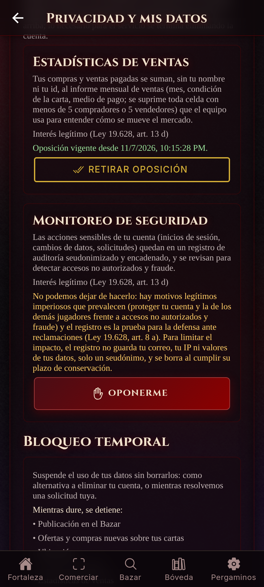
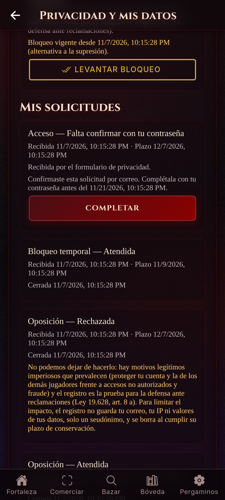
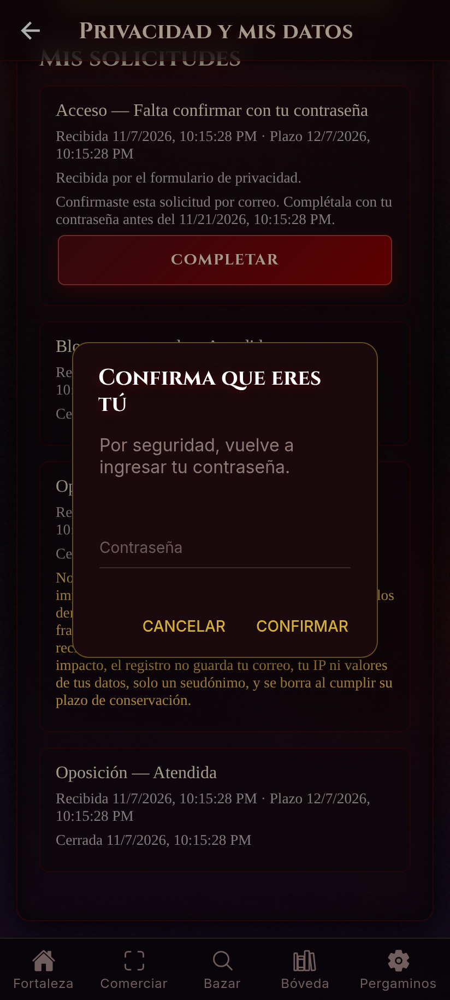
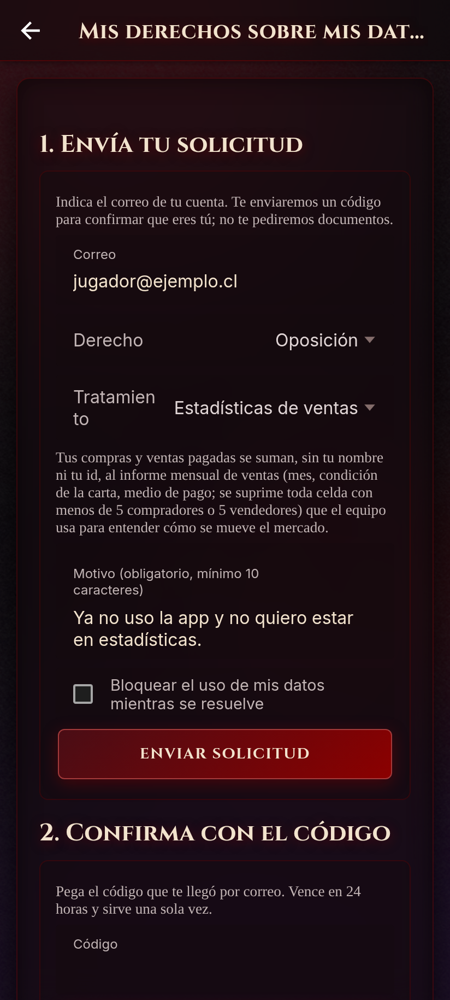
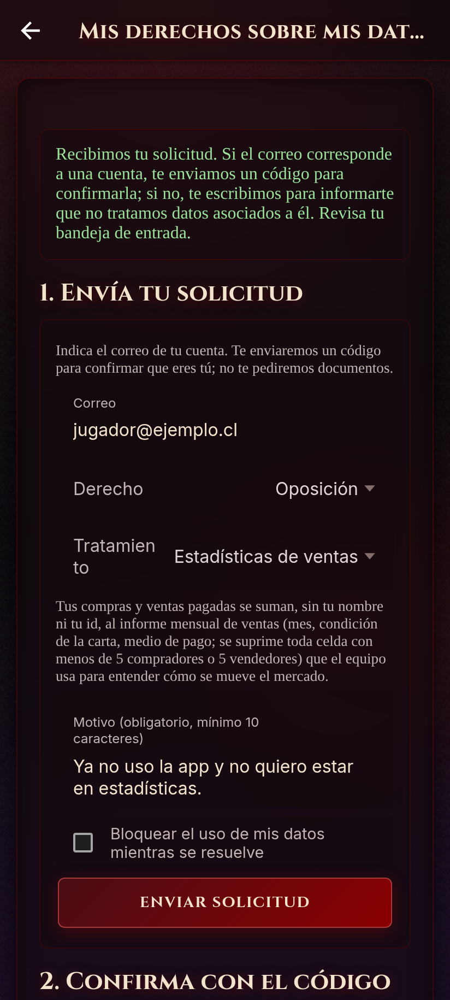
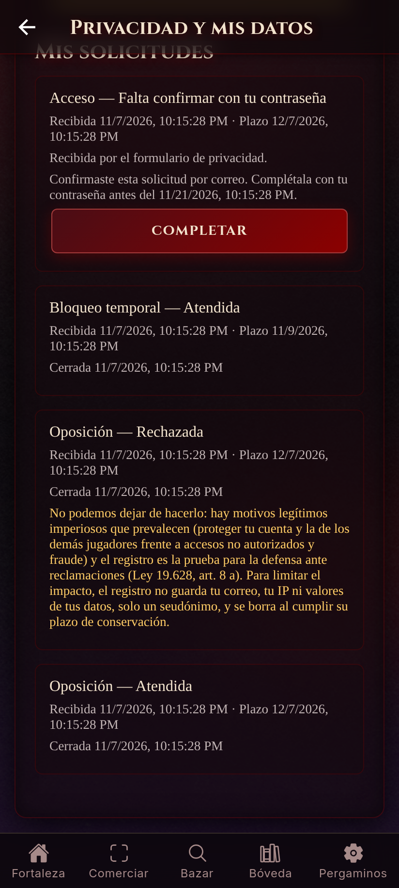

# Actividad N°6 — Implementar los mecanismos de derechos

**Nombre:** Grupo MTG Companion  
**Integrantes:** Vicente Fuentes, Tomás Rodriguez, Tomás Solano  
**Fecha:** 7 nov 2026  
**Proyecto:** MTG Companion, una app de compraventa de cartas Magic (`apps/`), con backend NestJS + Prisma + PostgreSQL y cliente Ionic/React  
**Repositorio:** https://github.com/inzenfenix/MTGCompanion_TCG · tarea: [issue #150](https://github.com/inzenfenix/MTGCompanion_TCG/issues/150) · fila O16 de `ROADMAP.md`  
**Insumos:** inventario de datos del Hito 1 ([`hito1/`](hito1/)), rediseño y RBAC de la Actividad N°4 ([`ACTIVIDAD_4.md`](ACTIVIDAD_4.md)) y módulo de consentimiento y derechos de la Actividad N°5 ([`ACTIVIDAD_5.md`](ACTIVIDAD_5.md))

La Actividad N°5 ya dejó implementados el acceso y la portabilidad, la rectificación y la supresión, con verificación por *step-up*. Esta entrega:

- **revisa esos mecanismos** contra los siete puntos de la actividad, con evidencia nueva;
- **implementa lo que faltaba**, que la propia Actividad N°5 dejó como limitación pendiente:
  - **derecho de oposición** (art. 8);
  - **derecho de bloqueo** (arts. 8 ter y 11);
  - **canal fuera de la app**, para quien no puede o no quiere iniciar sesión (art. 11).

Cada punto se probó con solicitudes concretas sobre el backend real (§7). Las transcripciones y capturas están en [`evidencia/actividad6/`](evidencia/actividad6/).

**Marco legal.** Se cita la Ley 19.628 en el texto que le da la **Ley 21.719**, vigente desde el **01-12-2026**, igual que en las entregas anteriores. Cada artículo citado se verificó contra el texto publicado en la BCN (versión con vigencia 01-12-2026).

---

## 1. Canal de solicitudes y modelo de seguimiento

### 1.1 Canales

El art. 11 pide que la solicitud se presente "dirigida a la dirección de correo electrónico establecida para este fin, un formulario de contacto o un medio electrónico equivalente". Hay dos canales y ambos terminan en la misma tabla y el mismo ciclo de vida.

| Canal | Ruta | Para quién | Identidad |
|---|---|---|---|
| **APP** | `POST /data-rights/requests` (pantalla *Privacidad y mis datos*) | El titular con sesión | Sesión + *step-up* según el riesgo (§2) |
| **EMAIL_FORM** | `POST /data-rights/public-requests` + `POST …/confirm` (pantalla pública `/derechos`, enlazada desde el inicio de sesión) | Quien no puede o no quiere entrar a la app | Código de un solo uso enviado al correo de la cuenta (§2) |

El formulario público pide lo mínimo que exige el art. 11: el correo, el derecho, el tratamiento (en una oposición) y el motivo cuando la ley lo exige. **No pide documentos ni carnet.**

### 1.2 Modelo de datos

La tabla es `data_rights_requests`. Se creó en la Actividad N°5 y en esta entrega se le agregan columnas. El modelo completo, tal como quedó en la BD, está en [`01_canal_y_modelo.txt`](evidencia/actividad6/01_canal_y_modelo.txt).

| Columna | Para qué |
|---|---|
| `type` | `ACCESS`, `RECTIFICATION`, `ERASURE`, **`OBJECTION`**, **`BLOCKING`** |
| `channel` | **`APP` / `EMAIL_FORM`** |
| `status` | **`AWAITING_CONFIRMATION`** → **`PENDING_STEP_UP`** → `RECEIVED` → `VERIFIED` → `IN_EVALUATION` → `CLOSED` |
| `outcome` | `FULFILLED` / `DENIED` |
| `receivedAt`, `verifiedAt`, `evaluatedAt`, `executedAt`, `closedAt` | Fecha de cada etapa |
| `dueAt` | Plazo legal: 30 días corridos; **2 días hábiles para el bloqueo** (art. 11) |
| `verificationMethod` | `session`, `password`, `password+totp`, **`email-link`**, **`email-link+password`** |
| `details` | Nombres de campos, códigos de motivo y conteos. **Nunca valores** |
| `scope` | Tratamiento objetado (`SALES_STATISTICS`) o base del bloqueo (`ALTERNATIVE_TO_ERASURE` / `PENDING_REQUEST`) |
| `statement` | Fundamento del titular (art. 11 d). Se borra si se elimina la cuenta |
| `relatedRequestId`, `requestBlocking` | Bloqueo ligado a una solicitud pendiente |
| `contactPseudonym` | Seudónimo HMAC del correo (formulario): sirve para el tope por dirección y como prueba de respuesta sin guardar el correo |
| `confirmTokenHash`, `expiresAt` | SHA-256 del código de confirmación (nunca el código) y plazo del siguiente paso del titular |

Una tabla nueva, `processing_controls`, guarda lo que deja una oposición acogida o un bloqueo concedido:

- **Columnas:** tipo, alcance, base, estado `ACTIVE`/`LIFTED`, fechas y motivo del levantamiento.
- **Índice `UNIQUE` parcial:** impide dos controles activos iguales.
- **Trigger:** impide reactivar uno levantado. Así el historial no se reescribe.

### 1.3 Ciclo de vida y seguimiento

```
 (formulario) AWAITING_CONFIRMATION ──código──► PENDING_STEP_UP ──step-up en la app──┐
                     │ 24 h sin confirmar              │ 14 días sin completar     │
                     └──────────► CLOSED DENIED ◄──────┘                           ▼
 (app)  RECEIVED ─► VERIFIED ─► IN_EVALUATION ─► (ejecución) ─► CLOSED FULFILLED / DENIED + motivo
```

- **El titular** sigue sus solicitudes en `GET /data-rights/requests`, con el estado, el plazo y el motivo de una denegación. En la app, las del formulario muestran el botón **"Completar"**.
- **SUPPORT y ADMIN** ven `GET /admin/data-rights/requests` (permiso `DATA_REQUESTS_READ`):
  - tipo, canal, estado, plazo y marca `overdue`;
  - el sujeto **seudonimizado**;
  - sin contenidos.
- **Respuesta escrita (art. 11):** cada cierre envía al correo del titular la decisión y, si es una denegación, el motivo y el plazo de 30 días hábiles para reclamar ante la Agencia. Los correos reales de la corrida están en [`08_correos.txt`](evidencia/actividad6/08_correos.txt).
- **Solicitudes vencidas:** un barrido cada hora cierra las del formulario que vencieron (`DataRightsService.expireStale`).

---

## 2. Verificación de identidad antes de atender

Ninguna solicitud se ejecuta antes de que la identidad quede verificada al nivel que exige su riesgo. La regla vive en una sola función ([`rights-policy.ts`](../../apps/backend/src/data-rights/domain/rights-policy.ts), con pruebas unitarias).

| Solicitud | En la app | Por el formulario | Por qué |
|---|---|---|---|
| Acceso / portabilidad | Sesión **+ step-up** | Código del correo **y además** step-up en la app | Entrega todos los datos de una vez |
| Supresión | Sesión **+ step-up** + `confirmErasure: true` | Código **y además** step-up | Es irreversible |
| Rectificación del correo | Sesión **+ step-up** | Código **y además** step-up | Quien cambia el correo toma la cuenta |
| Rectificación de alias o idioma | Sesión | Código **y además** sesión | Bajo impacto; el titular lo revierte |
| **Oposición** | Sesión | **Código del correo** | Restringe un tratamiento, no entrega nada y el titular la puede retirar |
| **Bloqueo** | Sesión | Junto con su solicitud, al confirmar el código | Igual que la oposición: solo restringe |

**Step-up** (de la Actividad N°5):

- se obtiene con `POST /auth/step-up` y la contraseña, más el código TOTP si la cuenta tiene 2FA;
- dura 5 minutos y es de un solo uso (`UNIQUE` en la BD);
- solo sirve para su titular;
- no sirve como token de acceso.

**Código del formulario:**

- son 32 bytes aleatorios y se envían **solo al correo de la cuenta**;
- en la BD se guarda únicamente su SHA-256;
- vence a las 24 h y se consume de forma atómica (`UPDATE … WHERE confirmTokenHash = …`), así que no se puede usar dos veces.

**El formulario no revela si un correo tiene cuenta.** La respuesta es siempre la misma. El resultado se le comunica al buzón, que solo lee su dueño:

- **dirección sin cuenta:** recibe "no tratamos datos asociados a este correo", y la fila queda con el seudónimo, sin el correo;
- **dirección con cuenta:** recibe el código.

**Contra el abuso del formulario:** se aceptan como máximo **3 envíos por dirección en 24 h**. Los siguientes no crean fila ni envían correo, pero quedan auditados como `throttled`. Así nadie puede usar el formulario para llenar de correos la bandeja de otra persona.

Las pruebas con solicitantes **no verificados** están en §7.

---

## 3. Acceso y portabilidad

`POST /data-rights/requests {type: "ACCESS", stepUpToken}`, o por el formulario seguido de "Completar". Evidencia: [`03_acceso_portabilidad.txt`](evidencia/actividad6/03_acceso_portabilidad.txt) y la exportación completa de ejemplo, [`03_export_ejemplo.json`](evidencia/actividad6/03_export_ejemplo.json).

**Formato.** Es un archivo JSON (`format: "mtg-companion/personal-data-export"`, `version: 1`): el "formato electrónico estructurado, genérico y de uso común" que pide el art. 9. Se entrega una vez y **no se guarda**; la solicitud registra solo los nombres de las secciones.

**Todos los datos del titular:**

- cuenta y ajustes, incluida su propia ubicación descifrada si la compartía;
- consentimientos con su historial;
- cartas, mazos, ofertas hechas, transacciones y cupones;
- solicitudes anteriores;
- **oposiciones y bloqueos** (nuevo);
- `processing`, con la finalidad, la base, los destinatarios y el plazo de cada tratamiento, como pide el art. 5. Ahora incluye los dos tratamientos de interés legítimo y cómo oponerse.

**Solo los suyos.** Cada consulta se filtra por el id de la sesión; ninguna ruta recibe un id de usuario. En la corrida de evidencia, la exportación de *ana* (compradora en una venta de *beto*) se revisó así:

| Comprobación | Resultado |
|---|---|
| ¿Contiene el id de beto? | `false` |
| ¿Contiene el correo de beto? | `false` |
| ¿Contiene la nota privada que beto puso en su carta? | `false` |
| ¿Contiene secretos (hash de contraseña, secreto 2FA, tokens, `paymentRef`)? | `false` |
| ¿Cómo aparece la contraparte? | Solo por su alias público: `"Beto Seis"` |

Lo excluido a propósito se declara en la misma exportación (`notIncluded`), con su motivo:

- credenciales;
- datos de terceros;
- el registro de auditoría seudonimizado;
- referencias internas del proveedor de pagos.

---

## 4. Rectificación con registro del cambio

`POST /data-rights/requests {type: "RECTIFICATION", rectification: {displayName?, email?, language?}}`. Evidencia: [`04_rectificacion.txt`](evidencia/actividad6/04_rectificacion.txt).

**Validaciones.** Son las **mismas del registro**. Cualquier otro campo, por ejemplo `role`, da 400. Si no hay nada que cambiar, la solicitud se deniega con `NOTHING_TO_RECTIFY`.

**Registro del cambio:**

- La solicitud guarda **qué campos** cambiaron (`details.fields = ["displayName"]`), con la fecha de cada etapa y el método de verificación.
- La auditoría encadenada guarda `data.rectify` con `reason: "displayName"` o `"email"`.
- **Nunca se guardan los valores, ni el anterior ni el nuevo.** En la corrida, una consulta por el alias antiguo o el nuevo en `audit_logs` devuelve 0 filas.

**Cambio de correo:**

- exige *step-up*;
- borra la verificación del correo;
- **revoca todas las sesiones** (la siguiente petición con el token anterior da 401);
- avisa a la **dirección anterior** por si el cambio no lo hizo el titular. Ese correo se recibió en la corrida.

**Propagación (art. 11, inciso final):**

- El alias se lee por relación en cada consulta, así que no hay copias que actualizar. La contraparte lo ve corregido en la transacción compartida: `"comprador": "Ana Corregida"`.
- El sistema no comunica datos a otros responsables; el único destinatario externo es el proveedor de correo. Por eso no hay terceros a quienes informar la rectificación.

---

## 5. Supresión: qué se elimina, qué se bloquea por obligación legal y cómo se propaga

`POST /data-rights/requests {type: "ERASURE", confirmErasure: true, stepUpToken}`. Evidencia: [`05_supresion.txt`](evidencia/actividad6/05_supresion.txt).

### 5.1 Cuándo no procede (aún)

El art. 7 dice que "no procede la supresión cuando el tratamiento sea necesario: … ii. Para el cumplimiento de una obligación legal o la ejecución de un contrato suscrito entre el titular y el responsable". La denegación es **temporal y fundada**:

| Impedimento | Código |
|---|---|
| Compra o venta `PENDING` | `OPEN_TRANSACTIONS` |
| Subasta activa en la que vende o va ganando | `ACTIVE_AUCTION` |
| Rol SUPPORT o ADMIN (otro ADMIN debe quitárselo antes) | `ADMIN_ROLE` |

**Novedad:** el mensaje de denegación ahora ofrece el **bloqueo como alternativa** (art. 8 ter: "podrá ejercer este derecho alternativamente al de supresión"). En la corrida, *dani* tiene una venta pendiente:

1. se le deniega la supresión;
2. pide el bloqueo y se le concede;
3. cuando la venta se cierra, la supresión procede.

### 5.2 Qué se elimina

Todo se elimina en **una sola transacción de BD** ([`prisma-data-rights.repository.ts`](../../apps/backend/src/data-rights/infrastructure/prisma-data-rights.repository.ts)):

| Dato | Destino |
|---|---|
| Ajustes, ubicación, 2FA, sesiones | Se borran |
| Consentimientos y su historial | Se borran |
| **Oposiciones y bloqueos** (`processing_controls`) | Se borran (nuevo) |
| Mazos, ofertas, cupones no usados, cartas sin venta y sus fotos | Se borran |
| **Texto libre de las solicitudes del titular** (`statement`) | Se borra (nuevo); la fila queda como prueba de respuesta |
| La cuenta | **Se borra la fila** si no tiene transacciones. Si las tiene, queda una **lápida anónima**: `erased-<uuid>@erased.invalid`, alias "Cuenta eliminada", contraseña inutilizable |

### 5.3 Qué se bloquea por obligación legal

**Las transacciones cerradas y las cartas vendidas** se conservan **6 años** (Código Tributario, arts. 17 y 200; art. 7 ii). Quedan **sin la descripción libre** de la carta y apuntando a la lápida, que no identifica a nadie. En la corrida: `{"status":"PAID","amount":"5.00","vendedor":"Cuenta eliminada"}`.

El **registro de auditoría** se conserva seudonimizado hasta su plazo de retención. Es necesario para la defensa ante reclamaciones (art. 7 vi).

### 5.4 Cómo se propaga

| Dónde | Cómo |
|---|---|
| Base de datos | Una sola transacción: o se borra todo lo de §5.2 o nada |
| Sesiones vivas | `sessionsRevokedAt = now()`: todo token anterior da 401 (en la corrida, inmediatamente) |
| Bucket de fotos (S3/MinIO) | Se borra después del commit. Si falla, se cuenta en `storageObjectsPendingDeletion` en vez de revertir. En la corrida no había bucket: el conteo quedó en **1** y se registró |
| Contrapartes | Ven "Cuenta eliminada" porque la lectura es por relación, sin copias |
| Respaldos | No se editan. Al restaurar uno, se reaplican las supresiones registradas en `data_rights_requests` antes de abrir el servicio (plan de incidentes, Actividad N°5 §4.d) |
| Terceros (art. 11, inciso final) | El único destinatario es el proveedor de correo, que no conserva perfil; no hay otros responsables a quienes comunicar la supresión |

---

## 6. Oposición y bloqueo

### 6.1 Oposición (art. 8)

El art. 8 da derecho de oposición en tres casos: a) tratamientos basados en **interés legítimo**, b) marketing directo y c) datos de fuente pública sin otro fundamento.

**Tratamientos excluidos del catálogo:**

- **Los basados en contrato** (cuenta, publicaciones, compras): el art. 8 no les aplica; la salida es la supresión.
- **Los basados en consentimiento** (ubicación, correos opcionales, 2FA): se **revocan** en la misma pantalla (art. 12).
- **Marketing directo, perfiles y fuentes públicas** (letras b y c): la app no hace nada de eso.

**Qué tratamientos se pueden objetar.** El catálogo ([`objection-purposes.ts`](../../apps/backend/src/data-rights/domain/objection-purposes.ts)) tiene exactamente los dos tratamientos de interés legítimo (art. 13 d). La decisión de cada uno está escrita de antemano, así que no depende de quién atienda la solicitud:

| Tratamiento | Decisión | Fundamento |
|---|---|---|
| **`SALES_STATISTICS`**: las ventas pagadas del titular se suman, sin id ni nombre, al informe mensual de ventas con k-anonimato (Actividad N°4) | **Se acoge** | El informe no es necesario para dar el servicio; no hay motivo que prevalezca. Tampoco aplica la excepción estadística del art. 8, que exige "una función pública o … una actividad de interés público" |
| **`SECURITY_MONITORING`**: registro de auditoría seudonimizado y detección de accesos indebidos | **Se deniega, fundada** | Art. 8 a: hay "motivos legítimos imperiosos … que prevalezcan" (proteger la cuenta y la de los demás frente a accesos no autorizados y fraude) y el registro sirve "para la formulación, el ejercicio o la defensa de reclamaciones". El impacto ya está acotado: sin correo, sin IP, sin valores y con plazo de retención |

**Cómo se pide.** `POST /data-rights/requests {type: "OBJECTION", purpose, statement}`. El `statement` es obligatorio porque el art. 11 d dice que en la oposición del art. 8 a el titular "deberá fundamentar brevemente su petición". Un tratamiento fuera del catálogo da 400.

**Qué hace al acogerse.** Crea un control `OBJECTION/SALES_STATISTICS`. El informe lo consulta **en el propio SQL** (`NOT EXISTS` sobre `processing_controls`), así que rige desde la consulta siguiente. El titular la retira con `DELETE /data-rights/controls/objections/SALES_STATISTICS`.

**Evidencia** ([`06_oposicion_bloqueo.txt`](evidencia/actividad6/06_oposicion_bloqueo.txt)). Hay 6 ventas de 6 vendedores a 6 compradores en una misma celda del informe:

| Momento | Celda 2001-01 |
|---|---|
| Antes | ventas = 6 |
| Tras la oposición de un vendedor | **ventas = 5** |
| Tras retirarla | ventas = 6 |

La oposición a `SECURITY_MONITORING` quedó **denegada con su fundamento**, en la respuesta, en la app y en el correo, junto con el aviso del plazo para reclamar ante la Agencia.

### 6.2 Bloqueo (arts. 8 ter y 11)

**Cuándo procede.** El art. 8 ter permite pedir "la suspensión temporal de cualquier operación de tratamiento" en dos casos:

1. **Mientras se resuelve una rectificación, supresión u oposición** (`basis: PENDING_REQUEST`):
   - el titular la pide marcando "Bloquear mientras se resuelve" en el formulario, o
   - desde la app, sobre una solicitud suya abierta.

   Se **levanta sola** al cerrarse esa solicitud (`liftReason: RELATED_REQUEST_CLOSED`).
2. **En vez de la supresión** (`basis: ALTERNATIVE_TO_ERASURE`). Dura hasta que el titular la levanta.

**Requisitos (art. 11).** La solicitud de bloqueo "deberá ser fundada" (`statement` obligatorio) y se responde "dentro de los dos días hábiles siguientes": `dueAt` se calcula en días hábiles. El sistema la resuelve en el acto.

**Qué detiene.** El bloqueo "no afectará el almacenamiento", y mientras dura "el responsable no podrá tratar los datos del titular". Cada efecto está en el código que lo aplica, se le muestra al titular antes de pedirlo ([`blocking-scope.ts`](../../apps/backend/src/data-rights/domain/blocking-scope.ts)) y se probó:

| Se detiene | Dónde se aplica | Resultado en la corrida |
|---|---|---|
| Publicación en el Bazar | Filtro en la consulta (`PrismaCardRepository.searchListings`) | La búsqueda devuelve `[]` |
| Ofertas y compras **nuevas** sobre sus cartas | `OffersService`, `TransactionsService` | **409** |
| Guardar ubicación, aun con consentimiento vigente | `UsersService.updateLocation` | **403** |
| Correos opcionales, aun con consentimiento vigente | `PrivacyListeners` | Ninguno enviado (prueba e2e) |
| Estadísticas de ventas | SQL del informe | Celda: 6 → **5** |

| No se detiene | Por qué |
|---|---|
| El almacenamiento | El art. 8 ter lo dice expresamente. La carta sigue legible por su id |
| El acceso del titular a la app y a sus datos | Lo necesita para seguir su solicitud y levantar el bloqueo |
| Compras ya acordadas (pendientes o subastas ganadas) y sus comprobantes | Son contratos ya formados con un tercero y obligaciones tributarias (art. 13 b y c). El bloqueo no puede servir para incumplirlos |
| El registro de auditoría | Es seudonimizado y prueba, entre otras cosas, que el bloqueo se respetó |

**Casos que se deniegan.** Un bloqueo "mientras se resuelve" sobre una solicitud **ya cerrada** o **ajena** se deniega (`NO_PENDING_REQUEST`). La solicitud ajena se busca filtrada por el dueño, así que es indistinguible de una que no existe.

**Levantar el bloqueo.** El titular lo hace con `DELETE /data-rights/controls/blocking` y todo vuelve a funcionar; en la corrida, la oferta pasa a **201**.

**Integridad en la BD.** Reactivar un control levantado falla por el trigger (`a lifted control cannot be modified`). Un segundo control activo igual falla por el índice `processing_controls_one_active`.

### 6.3 Interfaz

| | | |
|---|---|---|
|  |  |  |
|  |  |  |

---

## 7. Pruebas con solicitudes concretas

Hay tres niveles de prueba, y todos corren sobre código real:

- **Unitarias:** [`07a_tests_unitarios.txt`](evidencia/actividad6/07a_tests_unitarios.txt) — **141/141**.
- **e2e:** API real sobre PostgreSQL 16 embebido; [`07b_tests_e2e.txt`](evidencia/actividad6/07b_tests_e2e.txt) — **180/183**. La suite nueva, `rights-objection-blocking`, pasa 24/24. Las 3 que fallan son de `catalog` y necesitan el catálogo de Scryfall importado, que no está en este equipo; ya fallaban igual en las Actividades 4 y 5.
- **App móvil:** [`07c_tests_mobile.txt`](evidencia/actividad6/07c_tests_mobile.txt) — **108/109**. La que falla necesita el modelo ONNX `stage1-detector.onnx`, que no está en este equipo.

Además, el generador [`actividad6.mjs`](../../apps/backend/test/evidence/actividad6.mjs) arranca el **backend compilado** con un **servidor SMTP local** y recorre cada mecanismo por HTTP. Así quedan transcripciones de las peticiones, las respuestas, la BD y los **correos realmente enviados**.

| Mecanismo | Solicitud concreta | Resultado | Evidencia |
|---|---|---|---|
| Canal + seguimiento | Rectificación en la app; acceso por el formulario recorriendo todos los estados | Fechas de cada etapa; plazo de 30 días / 2 días hábiles | `01` |
| Acceso | *ana* con step-up | JSON estructurado con todas sus secciones; nada de *beto* | `03` |
| Rectificación | Alias y correo de *ana* | Solo los nombres de campos en el registro; sesiones revocadas; aviso a la dirección anterior | `04` |
| Supresión | *dani* con venta pendiente, luego cerrada | Denegada fundada → bloqueo alternativo → lápida; transacción conservada | `05` |
| Oposición | Estadísticas (acogida) y seguridad (denegada) | Informe 6 → 5 → 6; denegación con fundamento | `06` |
| Bloqueo | Como alternativa, y mientras se resuelve una rectificación | Bazar, ofertas, compras, ubicación y estadísticas detenidos; se levanta al resolverse | `06` |

**Solicitantes no verificados** (art. 11 a, "autenticación de su identidad"):

| Intento | Respuesta |
|---|---|
| Solicitud sin sesión al canal de la app | **401** |
| Acceso con sesión pero **sin step-up** | Se registra y se cierra **DENIED `IDENTITY_NOT_VERIFIED`**; sin datos |
| Step-up con contraseña incorrecta | **401** (queda auditado) |
| Step-up **de otra cuenta** | **DENIED `IDENTITY_NOT_VERIFIED`** |
| Step-up **reutilizado** | **DENIED `STEP_UP_REUSED`** (`UNIQUE` en la BD) |
| Formulario **sin confirmar** | Queda `AWAITING_CONFIRMATION`: no se ejecuta nada y la cuenta sigue intacta |
| Código **falso** o **ya usado** | **400**, el mismo mensaje en ambos casos |
| Código **vencido** | Se cierra **DENIED `CONFIRMATION_EXPIRED`** sin efectos |
| Supresión del formulario confirmada por correo pero **completada sin contraseña** | **DENIED `IDENTITY_NOT_VERIFIED`**; la cuenta sigue existiendo |
| **Otra cuenta** intenta completar la solicitud ajena | **404** |
| 4.º envío del formulario a la misma dirección en 24 h | Descartado sin fila ni correo; auditado `throttled` |

---

## 8. Implementación

Archivos nuevos y modificados (commit de implementación en `main`, `Refs #150`):

| Capa | Archivos |
|---|---|
| Migración | `apps/backend/prisma/migrations/20261107120000_rights_objection_blocking_channel/` |
| Dominio | `data-rights/domain/objection-purposes.ts`, `blocking-scope.ts`, `rights-policy.ts` (plazos en días hábiles, `mailboxProofSuffices`, `blockingDenial`) |
| Aplicación | `data-rights/application/data-rights.service.ts` (canal público, `complete`, oposición, bloqueo, barrido de vencidas) |
| Módulo nuevo | `processing-control/` (dominio, aplicación, infraestructura), consultado por usuarios, tarjetas, ofertas, transacciones, notificaciones y el informe de administración |
| Presentación | `data-rights.controller.ts` (`ProcessingControlsController`, `PublicDataRightsController`), DTOs |
| Correo | `notifications/templates/privacy-emails.ts` (código de confirmación, "completa tu solicitud", respuestas de oposición y bloqueo) |
| App | `apps/mobile/src/pages/Privacy.tsx` (oposición, bloqueo, "Completar"), `RightsPublic.tsx` (`/derechos`), `Onboarding.tsx`, `lib/api.ts`, textos es-LA/en/fr |
| Pruebas | `rights-policy.spec.ts`, `test/rights-objection-blocking.e2e-spec.ts`, `Privacy.test.tsx`, `RightsPublic.test.tsx` |
| Evidencia | `apps/backend/test/evidence/actividad6.mjs`, `screenshots6.mjs` |

**Configuración nueva:** `PUBLIC_APP_URL` (opcional). Si existe, el correo de confirmación lleva un enlace de un clic; si no, lleva solo el código. No hay secretos nuevos.

---

## 9. Justificación y limitaciones

### Decisiones

- **Las decisiones de oposición están en un catálogo, no en manos de quien atiende.** El art. 11 exige que una denegación sea fundada. Escribir el fundamento de antemano, por tratamiento, lo hace igual para todos y verificable en el código.
- **El bloqueo se aplica donde ocurre el tratamiento.** El filtro está en las consultas (Bazar, informe) y en los servicios (ofertas, compras, ubicación, correos), no en la pantalla. Así no se puede saltar desde otro cliente.
- **El formulario no es una puerta trasera.** La prueba del buzón solo alcanza para lo que restringe (oposición y bloqueo). Lo que entrega, cambia o borra datos exige además la contraseña, igual que dentro de la app.
- **Minimización:**
  - no se guarda el correo de quien escribe sin tener cuenta;
  - no se guarda el código de confirmación;
  - el texto libre del titular se borra con su cuenta;
  - la auditoría guarda códigos, nunca valores.

### Limitaciones pendientes

- **TLS (O5/I6) sigue pendiente.** Es el mayor riesgo: el formulario, el código y la exportación viajan sin cifrar en el despliegue actual de AWS.
- **Plazo del bloqueo.** Los días hábiles se calculan de lunes a viernes, sin feriados chilenos. El plazo calculado puede quedar *antes* que el legal, nunca después. Hasta el 30-11-2026 rige el texto anterior de la ley (respuesta en 2 días hábiles): las solicitudes que el sistema resuelve solo se cierran en el acto y cumplen ese plazo, pero las del formulario que esperan el *step-up* dependen de que el titular las complete. Hasta esa fecha, el equipo debe responderlas por escrito dentro de 2 días hábiles aunque el titular no las haya completado.
- **La prueba del buzón vale lo que vale el correo.** Quien controla el correo de una cuenta puede objetar o bloquear en su nombre. Ese mismo atacante igual podría tomar la cuenta, y ambas medidas son reversibles por el titular.
- **Correos.** En este equipo se probaron con un servidor SMTP local que los recibe y transcribe, no con entrega real por Amazon SES.
- **Portabilidad directa entre responsables** (art. 9, "cuando sea técnicamente posible"): no hay otro responsable con quien intercambiar. La exportación JSON se puede llevar a cualquiera.
- **No verificado aquí:** un despliegue en AWS con estos cambios y `terraform validate`. No hay variables de infraestructura obligatorias nuevas.
- **Siguen abiertos de entregas anteriores:** rol `mtg_app` sin conectar al despliegue (O14) y respaldos con rotación no verificada (Actividad N°5).

---

## Referencias

- Ley N° 19.628, sobre protección de la vida privada, texto modificado por la Ley N° 21.719 (D.O. 13-12-2024), vigente desde el 01-12-2026: arts. 5, 6, 7, 8, 8 ter, 9, 11, 12 y 13. Biblioteca del Congreso Nacional, https://www.bcn.cl/leychile/navegar?idNorma=141599
- Decreto Ley N° 830, Código Tributario, arts. 17 y 200.
- Grupo MTG Companion: Hito 1 (inventario), Actividad N°4 (rediseño, seudonimización, RBAC) y Actividad N°5 (consentimiento, derechos, auditoría, incidentes), en `docs/security/`.
